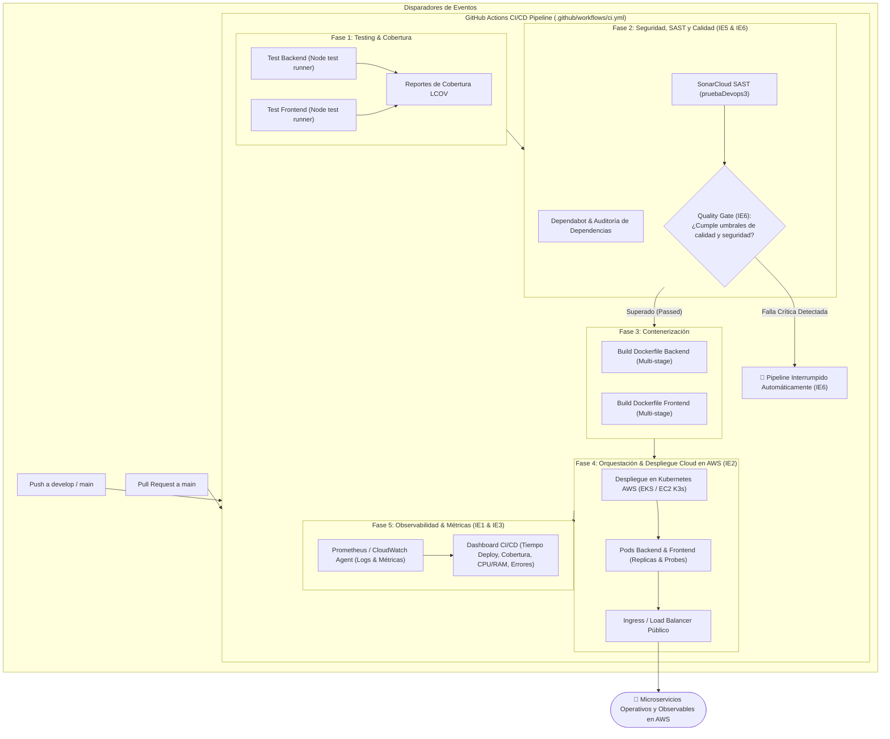

# Microservicio DevOps — Evaluación Parcial N°3: Observabilidad y Entornos Reales en DevOps

> **Asignatura:** DOY0101 - Ingeniería DevOps  
> **Institución:** Duoc UC  
> **Evaluación:** Evaluación Parcial 3 (30% ponderación)  
> **Estado:** 🟡 En Desarrollo / Implementación de Observabilidad, K8s en AWS y Gobernanza  
> **Matriz y Checklist:** [docs/CHECKLIST_EP3.md](docs/CHECKLIST_EP3.md)

[](https://github.com/iTzAsaro/pruebaDevops3/actions/workflows/ci.yml)
[](https://sonarcloud.io/summary/new_code?id=iTzAsaro_pruebaDevops3)
[](https://sonarcloud.io/summary/new_code?id=iTzAsaro_pruebaDevops3)
[](https://sonarcloud.io/summary/new_code?id=iTzAsaro_pruebaDevops3)

---

## 👥 Equipo de Trabajo y Roles (EP3)

| Integrante | Rol en el Proyecto | Responsabilidad Principal en EP3 | Indicadores de Evaluación |
| :--- | :--- | :--- | :--- |
| **Paulo Rivas** | **Cloud & Infrastructure Engineer (AWS Specialist)** | Aprovisionamiento y despliegue orquestado en la nube AWS con Kubernetes, manifiestos K8s, exposición Ingress/LB y soporte de observabilidad cloud. | **IE2 (K8s en AWS)** & **IE1 (Cloud)** |
| **Kevin** | **Observability & Dashboards Engineer** | Instrumentación de métricas de aplicación en microservicios (`/metrics` Prometheus), logging estructurado y creación de dashboards CI/CD con las 4 métricas clave. | **IE1 (Monitoreo & Logs)** & **IE3 (Dashboards)** |
| **Alexsander Rosales** | **Tech Lead, Security & Governance Engineer** | Orquestación del pipeline CI/CD en GitHub Actions, Quality Gate estricto en SonarCloud, Branch Protection, corte ante fallas críticas y documentación técnica. | **IE5 (Cumplimiento)**, **IE6 (Fail-Safe)** & **IE4 (Docs)** |

---

## 🎯 Propósito del Proyecto (EP3: Observabilidad y Entornos Reales en DevOps)

El encargo de la **Evaluación Parcial N°3** consiste en extender el pipeline DevOps implementado, incorporando mecanismos de **observabilidad**, **métricas de desempeño y calidad**, despliegue en entornos orquestados en la nube (**Kubernetes en AWS**) y **validación automatizada de cumplimiento normativo**, garantizando una operación confiable, transparente y alineada a estándares de calidad:

1. **Monitoreo y Logging (IE1 - 20%):** Configuración de herramientas como Prometheus o AWS CloudWatch para visualizar logs, métricas de uso, errores y disponibilidad del microservicio.
2. **Despliegue Orquestado en la Nube (IE2 - 20%):** Despliegue de los microservicios en un clúster Kubernetes en AWS, integrando configuraciones automatizadas de monitoreo y observabilidad.
3. **Dashboards Personalizados en CI/CD (IE3 - 10%):** Creación de dashboards con métricas clave: tiempo de despliegue, cobertura de pruebas, uso de CPU/memoria y errores registrados.
4. **Documentación Técnica y Toma de Decisiones (IE4 - 10%):** Documentación de la integración de observabilidad y justificación de cómo las métricas fundamentan decisiones técnicas y mejora continua.
5. **Políticas de Cumplimiento (IE5 - 20%):** Aplicación rigurosa de políticas mediante SonarCloud (`pruebaDevops3`), Branch Protection Rules en GitHub y scripts de auditoría automatizada.
6. **Mecanismo de Bloqueo ante Fallas Críticas (IE6 - 20%):** Demostración empírica de que el pipeline se interrumpe automáticamente ante fallas críticas de seguridad o calidad, protegiendo producción.

---

## 🏗️ Arquitectura del Pipeline CI/CD & Observabilidad



---

## 📂 Estructura del Repositorio

```text
├── .github/
│   ├── dependabot.yml           # Escaneo semanal de dependencias npm y actions
│   └── workflows/
│       └── ci.yml               # Pipeline CI/CD automatizado con Quality Gate y despliegue
├── docs/
│   ├── EP3_DOY0101_Estudiante.pdf # Enunciado y rúbrica oficial de la evaluación (EP3)
│   ├── CHECKLIST_EP3.md          # Matriz de delegación, verificación y checklist 100%
│   └── evidencias/               # Capturas y salidas de consola de cada indicador (IE1-IE6)
├── backend/                     # Microservicio API REST (Alexsander Rosales)
│   ├── src/
│   │   ├── controllers/         # Controladores de catálogo y órdenes
│   │   ├── middleware/          # CORS y logger HTTP estructurado
│   │   ├── router.js            # Enrutador REST nativo
│   │   └── server.js            # Servidor HTTP con healthcheck y métricas
│   ├── tests/
│   │   └── backend.test.js      # 10 Pruebas unitarias nativas (Node test runner)
│   ├── Dockerfile               # Contenerización Multi-Stage (Kevin)
│   ├── .dockerignore            # Exclusión de temporales y logs
│   ├── package.json             # Scripts y metadatos
│   └── README.md                # Documentación de endpoints
├── frontend/                    # Cliente Web SPA Dark HUD (Kevin)
│   ├── public/                  # Shell HTML e iconos
│   ├── src/                     # Componentes, vistas SPA, catálogo y store
│   ├── tests/
│   │   └── frontend.test.js     # 9 Pruebas unitarias nativas de interfaz
│   ├── Dockerfile               # Contenerización Multi-Stage
│   ├── .dockerignore            # Exclusión de dependencias
│   ├── package.json             # Scripts de interfaz
│   └── README.md                # Documentación del cliente
├── docker-compose.yml           # Orquestación de servicios con healthchecks y redes (Paulo Rivas)
├── CHANGELOG.md                 # Registro semántico de versiones (Keep a Changelog)
├── CODE_OF_CONDUCT.md           # Normas de conducta y colaboración
├── CONTRIBUTING.md              # Convenciones de GitFlow, commits y PRs
├── LICENSE.md                   # Licencia MIT
└── README.md                    # Este documento maestro
```

---

## ⚙️ Ejecución y Pruebas Locales

### Requisitos Previos
* [Node.js](https://nodejs.org/) v18+ (LTS recomendado).
* [Docker](https://www.docker.com/) y Docker Compose instalados.
* [Git](https://git-scm.com/) configurado localmente.

### 1. Ejecución de Pruebas Unitarias
Ambas suites utilizan el motor nativo de pruebas de Node.js, ejecutándose sin dependencias pesadas:
```bash
# Probar el microservicio Backend (10 pruebas)
cd backend
npm test

# Probar la interfaz Frontend (14 pruebas)
cd ../frontend
npm test
```

### 2. Cobertura de pruebas (IE2)

Cada módulo conserva `npm test` y expone `npm run test:coverage`, que genera salida legible y LCOV mediante `c8`:

```bash
cd backend && npm run test:coverage
cd ../frontend && npm run test:coverage
```

Los reportes quedan en `backend/coverage/lcov.info` y `frontend/coverage/lcov.info`. `coverage/` está excluido de Git y Docker.

### 3. Levantamiento con Docker Compose (Orquestación Local)

#### 3.1 Modo producción (imágenes inmutables)

Construye las imágenes desde los `Dockerfile` y levanta el stack en una red aislada con healthchecks activos:

```bash
docker compose up --build -d
```

* **Frontend:** Disponible en `http://localhost:5000`
* **Backend API:** Disponible en `http://localhost:3000/api`
* **Healthcheck:** Verificar estado en `http://localhost:3000/api/health`

En este modo el código queda **horneado dentro de la imagen** (`COPY` en el `Dockerfile`). Si modificas un archivo, debes reconstruir:

```bash
docker compose up --build -d
```

#### 3.2 Modo desarrollo (recarga en vivo)

Para iterar sin reconstruir imágenes, el overlay `docker-compose.dev.yml` monta el código del host dentro de los contenedores:

```bash
npm run dev        # primer plano, con logs
npm run dev:up     # en segundo plano
```

Equivale a:

```bash
docker compose -f docker-compose.yml -f docker-compose.dev.yml up --build
```

| Servicio | Montaje | Efecto |
| :--- | :--- | :--- |
| **Frontend** | `./frontend/src` → `/app/src` | Los módulos ES y el CSS se leen del disco en cada request: guardas y recargas el navegador |
| **Frontend** | `./frontend/public` → `/app/public` | `index.html` se sirve actualizado |
| **Frontend** | `./frontend/server.js` → `/app/server.js` | Cambios en el servidor estático requieren `docker compose restart frontend` |
| **Backend** | `./backend/src` → `/app/src` | `node --watch` reinicia el proceso automáticamente al guardar |

En desarrollo el servidor envía `Cache-Control: no-cache`, de modo que el navegador no muestra versiones antiguas.

El pipeline de CI **no** usa este overlay: sigue construyendo y validando las imágenes de producción con `docker-compose.yml` (IE1 e IE4).

#### 3.3 Comandos útiles

```bash
npm run ps         # estado de los servicios
npm run logs       # logs en streaming
npm run smoke      # healthcheck + frontend en una línea
npm run down       # detener el stack
```

---

## 📊 Matriz de Cumplimiento de Rúbrica EP3 (100% Muy Buen Desempeño)

Para el detalle completo de tareas, responsables, comandos de prueba y criterios de verificación, consultar la matriz maestra en [**`docs/CHECKLIST_EP3.md`**](./docs/CHECKLIST_EP3.md).

| Indicador | Ponderación | Responsable | Criterio de Logro (100% Muy Buen Desempeño) | Estado |
| :--- | :---: | :---: | :--- | :---: |
| **IE1: Monitoreo & Logs** | **20%** | **Kevin** | Herramientas como Prometheus o AWS CloudWatch configuradas con visualización de logs estructurados, métricas de uso, errores y disponibilidad de todos los microservicios. | 🟡 En Desarrollo |
| **IE2: Despliegue K8s AWS** | **20%** | **Paulo** | Despliegue eficaz de microservicios en clúster Kubernetes en AWS con configuraciones automatizadas de monitoreo, trazabilidad y observabilidad. | 🟡 En Desarrollo |
| **IE3: Dashboards CI/CD** | **10%** | **Kevin** | Dashboards funcionales con las 4 métricas clave (tiempo de despliegue, cobertura, CPU/RAM, errores) integrados al proceso CI/CD. | 🟡 En Desarrollo |
| **IE4: Documentación Técnica** | **10%** | **Alexsander** | Documentación clara de la integración de herramientas y justificación fundada de su aporte a la toma de decisiones técnicas. | 🟡 En Desarrollo |
| **IE5: Cumplimiento y Auditoría**| **20%** | **Alexsander** | Políticas rigurosas con SonarCloud (`pruebaDevops3`), Branch Protection Rules y auditorías de seguridad automatizadas. | 🟡 En Desarrollo |
| **IE6: Bloqueo Fallas Críticas** | **20%** | **Alexsander** | Mecanismos de validación automatizados que interrumpen el pipeline ante fallas críticas de seguridad o calidad (fail-on-error). | 🟡 En Desarrollo |

> 📁 **Evidencias y Verificación Técnica:**
> Todas las evidencias de ejecución, capturas y salidas de consola requeridas por la rúbrica se gestionan en [**`docs/CHECKLIST_EP3.md`**](./docs/CHECKLIST_EP3.md) y se almacenan en el directorio [**`docs/evidencias/`**](./docs/evidencias/).

---

## 🔍 Trazabilidad, Gobernanza y Toma de Decisiones Técnicas (IE4)

La trazabilidad del ciclo de vida en esta etapa vincula el desarrollo, las compuertas de seguridad, el despliegue orquestado y la observabilidad en tiempo real:

1. **Trazabilidad de Código a Clúster:** Cada imagen y despliegue en Kubernetes se etiqueta con el hash SHA del commit (`$GITHUB_SHA`) y la rama de trabajo, garantizando correlación directa entre código y pods en ejecución.
2. **Compuertas de Calidad y Cumplimiento Normativo (IE5 & IE6):** Ningún artefacto avanza a la etapa de despliegue en la nube sin superar las pruebas unitarias automatizadas y el Quality Gate estricto de SonarCloud con cero vulnerabilidades críticas.
3. **Observabilidad para Toma de Decisiones Técnicas:** Los dashboards personalizados consolidan métricas clave de consumo de recursos y tasas de error, permitiendo decisiones proactivas sobre autoescalado horizontal (HPA), límites de memoria y rollbacks automatizados.
4. **Auditoría Continua e Inmutable:** Cada ejecución en GitHub Actions genera registros de despliegue auditables con autor, timestamp UTC y verificación de salud de los endpoints.

---

## 🤖 Declaración de Uso Ético de Inteligencia Artificial

En cumplimiento con la política institucional de Duoc UC sobre el uso ético de tecnologías de inteligencia artificial:
* **Herramientas empleadas:** Antigravity CLI / Asistente IA.
* **Finalidad:** Apoyo en redacción estructurada, generación de diagramas Mermaid y estructuración de checklists técnicos de verificación.
* **Autoría y Responsabilidad:** Todas las ideas, análisis, configuraciones de infraestructura en AWS, métricas y decisiones técnicas son de autoría y responsabilidad exclusiva del equipo de estudiantes.

---

## ✍️ Reflexiones Individuales de Aprendizaje (Obligatorias - EP3)

> *Nota institucional:* Sección obligatoria redactada de manera individual por cada integrante sin asistencia de IA al culminar la evaluación, detallando su aprendizaje en observabilidad, orquestación en la nube y gobernanza DevOps.

### 1. Reflexión de Alexsander Rosales (Tech Lead, Security & Governance Engineer)
> *[Espacio reservado para redacción individual al cierre del encargo EP3]*

### 2. Reflexión de Kevin (Observability & Dashboards Engineer)
> *[Espacio reservado para redacción individual al cierre del encargo EP3]*

### 3. Reflexión de Paulo Rivas (Cloud & Infrastructure Engineer - AWS Specialist)
> *[Espacio reservado para redacción individual al cierre del encargo EP3]*
