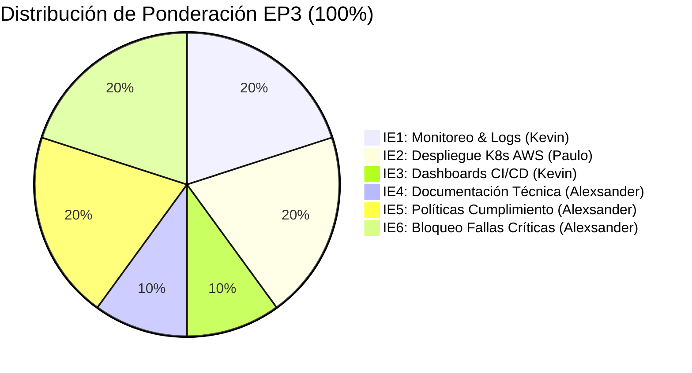

# 📋 CHECKLIST & MATRIZ DE DELEGACIÓN — EVALUACIÓN PARCIAL N°3 (EP3)

> **Asignatura:** DOY0101 - Ingeniería DevOps  
> **Institución:** Duoc UC  
> **Ponderación:** 30% de la nota final  
> **Encargo:** *Observabilidad y entornos reales en DevOps*  
> **Repositorio Oficial:** [iTzAsaro/pruebaDevops3](https://github.com/iTzAsaro/pruebaDevops3)  
> **Estado Global del Proyecto:** 🟡 En Planificación / Ejecución Inicial

---

## 👥 1. Equipo de Trabajo, Roles y Asignación de Tareas

En función de las directrices del proyecto y el perfil técnico de cada integrante, las responsabilidades se distribuyen de la siguiente manera:

| Integrante | Rol Oficial en EP3 | Indicadores Responsable | Área Principal de Dominio | Tareas Asignadas Clave |
| :--- | :--- | :--- | :--- | :--- |
| **Paulo Rivas** | **Cloud & Infrastructure Engineer (AWS Specialist)** | **IE2 (20%)**<br>**IE1 (Soporte Cloud)** | **Infraestructura Cloud AWS & Orquestación Kubernetes** | • Aprovisionamiento del entorno orquestado en AWS (EKS / clúster Kubernetes / K3s en EC2).<br>• Despliegue automatizado de microservicios (Backend y Frontend) en Kubernetes.<br>• Integración de agentes de observabilidad a nivel de clúster/nube (CloudWatch / Node Exporter / Ingress).<br>• Automatización del job de despliegue en la nube en el pipeline CI/CD.<br>• Generación de evidencias de pods, servicios, ingress y recursos activos en AWS. |
| **Kevin** | **Observability & Dashboards Engineer** | **IE1 (20%)**<br>**IE3 (10%)** | **Métricas, Logs y Dashboards de Desempeño** | • Instrumentación de métricas de aplicación en microservicios (endpoints `/metrics` Prometheus / logs JSON estructurados).<br>• Despliegue y configuración del stack de monitoreo (Prometheus + Grafana / AWS CloudWatch Metrics & Logs).<br>• Construcción de dashboards personalizados con las 4 métricas clave: **Tiempo de despliegue, Cobertura de pruebas, Uso de CPU/Memoria y Errores (5xx/4xx)**.<br>• Generación de evidencias visuales y exportación de dashboards (JSON / capturas). |
| **Alexsander Rosales** | **Tech Lead, Security & Governance Engineer** | **IE5 (20%)**<br>**IE6 (20%)**<br>**IE4 (10%)** | **Pipeline CI/CD, Seguridad, Calidad & Gobernanza** | • Orquestación del pipeline integral de GitHub Actions (`ci.yml`) vinculando testing, calidad, despliegue AWS y observabilidad.<br>• Integración y configuración de SonarQube/SonarCloud para `pruebaDevops3` con Quality Gate estricto.<br>• Reglas de Branch Protection en GitHub (`main` y `develop`).<br>• Implementación y PoC de fallo crítico de seguridad/calidad que **interrumpe el pipeline** (IE6).<br>• Documentación técnica integral (IE4), toma de decisiones y gobernanza del repositorio. |

---

## 📊 2. Matriz de Cobertura de Indicadores de Evaluación (100% Rúbrica)

Para obtener el **100% de logro (Muy Buen Desempeño)** en cada indicador, se deben cumplir rigurosamente los siguientes estándares:



| Indicador | Ponderación | Criterio para 100% (Muy Buen Desempeño) | Responsable | Estado |
| :---: | :---: | :--- | :---: | :---: |
| **IE1** | **20%** | Configura de manera completa y precisa herramientas como Prometheus o AWS CloudWatch, visualizando logs, métricas de uso, errores y disponibilidad de todos los microservicios involucrados. | **Kevin** | 🔴 Pendiente |
| **IE2** | **20%** | Despliega eficazmente microservicios en entornos orquestados en la nube (Kubernetes / AWS), integrando de forma automatizada todas las configuraciones necesarias para el monitoreo, trazabilidad y observabilidad. | **Paulo** | 🔴 Pendiente |
| **IE3** | **10%** | Crea dashboards funcionales y detallados con todas las métricas clave integradas al proceso CI/CD (tiempo despliegue, cobertura, CPU/RAM, errores), facilitando el análisis continuo del sistema. | **Kevin** | 🔴 Pendiente |
| **IE4** | **10%** | Documenta de forma clara y detallada la integración de herramientas de monitoreo, métricas y seguridad en el pipeline CI/CD, explicando su impacto en la toma de decisiones y mejora continua. | **Alexsander** | 🟢 Completado (Listo para Evidencia) |
| **IE5** | **20%** | Aplica rigurosamente políticas de cumplimiento usando herramientas automatizadas (SonarQube, branch protection rules o scripts de auditoría), garantizando calidad, seguridad y trazabilidad. | **Alexsander** | 🟢 Completado (Reglas y SAST activos) |
| **IE6** | **20%** | Implementa mecanismos de validación automatizados y efectivos que interrumpen el pipeline ante fallas críticas de seguridad o calidad, protegiendo el entorno productivo y asegurando cumplimiento normativo. | **Alexsander** | 🟢 Completado (Protocolo PoC Listo) |

---

## 📝 3. Checklist Detallado de Implementación y Verificación

### ☁️ IE2: Despliegue Orquestado en la Nube (AWS & Kubernetes) — *Responsable: Paulo Rivas* (20%)
- [ ] **Configuración de Infraestructura en AWS**:
  - [ ] Cuenta AWS y credenciales IAM configuradas para despliegue automatizado.
  - [ ] Clúster de Kubernetes activo en AWS (EKS o clúster multinodo / K3s en EC2).
  - [ ] Configuración de Redes (VPC, Subnets públicas, Security Groups permitiendo tráfico HTTP y métricas).
- [ ] **Manifiestos de Kubernetes (`k8s/`)**:
  - [ ] `namespace.yaml` para aislar el entorno de producción/staging (`vicity`).
  - [ ] `backend-deployment.yaml` con réplicas, límites de recursos (CPU/Memory requests & limits), probes (`livenessProbe` y `readinessProbe` en `/api/health`).
  - [ ] `backend-service.yaml` (ClusterIP).
  - [ ] `frontend-deployment.yaml` con límites de recursos y probes.
  - [ ] `frontend-service.yaml` (ClusterIP / LoadBalancer o NodePort).
  - [ ] `ingress.yaml` o LoadBalancer exponiendo los servicios a Internet.
  - [ ] ConfigMap / Secrets para variables de entorno sensibles.
- [ ] **Automatización del Despliegue en GitHub Actions**:
  - [ ] Job `deploy-cloud` en `.github/workflows/ci.yml` configurado para autenticar con AWS (OIDC o Secrets).
  - [ ] Despliegue continuo con `kubectl apply` o Helm ante cada push en `main`.
  - [ ] Verificación de rollout exitoso (`kubectl rollout status`).
- [ ] **Criterio de Aceptación & Evidencias**:
  - `EVIDENCIA_IE2_01`: Captura de consola AWS mostrando clúster/instancias activas.
  - `EVIDENCIA_IE2_02`: Salida de terminal `kubectl get nodes -o wide` y `kubectl get pods,svc,ingress -n vicity`.
  - `EVIDENCIA_IE2_03`: Curl exitoso a la URL pública de AWS mostrando respuesta 200 de frontend y backend.
  - `EVIDENCIA_IE2_04`: Log de GitHub Actions del job `deploy-cloud` completado en verde.

---

### 📈 IE1: Monitoreo, Métricas y Logs — *Responsable: Kevin* (20%)
- [ ] **Instrumentación de Microservicios**:
  - [ ] Backend: Endpoint `/metrics` exportando métricas estándar de Prometheus (`prom-client` en Node.js: peticiones HTTP, latencia, códigos de estado, uso de heap).
  - [ ] Backend: Endpoint `/api/health` reportando disponibilidad, uptime y estado de dependencias.
  - [ ] Logs estructurados (formato JSON) en Backend y Frontend con timestamp, nivel (`INFO`, `WARN`, `ERROR`), endpoint y código HTTP.
- [ ] **Stack de Monitoreo (Prometheus / AWS CloudWatch)**:
  - [ ] Prometheus configurado con `scrape_configs` apuntando a los pods/servicios del microservicio.
  - [ ] Recolección de logs configurada (CloudWatch Agent, FluentBit, Promtail o similar).
  - [ ] Captura de errores de aplicación y códigos HTTP 4xx/5xx en tiempo real.
  - [ ] Verificación de disponibilidad continua (*uptime check*).
- [ ] **Criterio de Aceptación & Evidencias**:
  - `EVIDENCIA_IE1_01`: Salida del endpoint `/metrics` en el microservicio.
  - `EVIDENCIA_IE1_02`: Panel de targets en Prometheus / CloudWatch con estado `UP`.
  - `EVIDENCIA_IE1_03`: Explorador de logs mostrando trazas estructuradas con errores y accesos.
  - `EVIDENCIA_IE1_04`: Gráfico de disponibilidad y latencia del servicio respondiendo a tráfico.

---

### 📊 IE3: Dashboards Personalizados Integrados a CI/CD — *Responsable: Kevin* (10%)
- [ ] **Construcción del Dashboard (Grafana / CloudWatch Dashboard)**:
  - [ ] **Métrica 1 — Tiempo de Despliegue (Deployment Duration)**: Duración histórica de las ejecuciones del pipeline CI/CD y despliegue en AWS.
  - [ ] **Métrica 2 — Cobertura de Pruebas (Test Coverage)**: Porcentaje de cobertura de pruebas unitarias extraído de las ejecuciones de CI.
  - [ ] **Métrica 3 — Uso de Recursos (CPU / Memoria)**: Consumo en tiempo real e histórico de los contenedores/pods en AWS.
  - [ ] **Métrica 4 — Errores Registrados**: Tasa de errores HTTP (5xx / 4xx) y excepciones no controladas en el microservicio.
- [ ] **Integración con CI/CD**:
  - [ ] Envío o exportación de métricas de build/test desde GitHub Actions hacia la herramienta de métricas.
  - [ ] Enlace o visualización del dashboard referenciado en el repositorio.
- [ ] **Criterio de Aceptación & Evidencias**:
  - `EVIDENCIA_IE3_01`: Captura completa del Dashboard mostrando los 4 paneles principales activos con datos reales.
  - `EVIDENCIA_IE3_02`: Consulta o query PromQL / CloudWatch Metric Math utilizada para cada panel.
  - `EVIDENCIA_IE3_03`: Exportación del archivo de definición del dashboard (`dashboard.json`).

---

### 🛡️ IE5: Políticas de Cumplimiento y Auditoría Automatizada — *Responsable: Alexsander Rosales* (20%)
- [x] **Configuración de SonarCloud / SonarQube para `pruebaDevops3`**:
  - [x] Archivo `sonar-project.properties` actualizado con `sonar.projectKey=iTzAsaro_pruebaDevops3` y `sonar.projectName=pruebaDevops3`.
  - [x] Vinculación de `SONAR_TOKEN` en GitHub Secrets del nuevo repositorio.
  - [x] Configuración del Quality Gate: 0 vulnerabilidades, 0 bugs críticos, cobertura mínima y deuda técnica controlada (`docs/POLITICAS_CUMPLIMIENTO_Y_AUDITORIA_IE5.md`).
- [x] **Reglas de Protección de Ramas (Branch Protection Rules)**:
  - [x] Protección en rama `main` y `develop`: Requerir PR para mergear, requerir aprobación de revisor (`.github/branch-protection-rules.json`).
  - [x] Requerir que los checks de CI (`unit-tests`, `security-audit`) pasen antes de hacer merge.
  - [x] Bloqueo de push directo y force-push (`git push --force`) en ramas protegidas.
- [x] **Auditoría Automatizada de Seguridad en CI**:
  - [x] Escaneo de dependencias vulnerables (`npm audit --audit-level=high` con fail-safe exit 1).
  - [x] Detección de fugas de secretos (`gitleaks` y detector regex multi-patrón en CI).
- [ ] **Criterio de Aceptación & Evidencias**:
  - `EVIDENCIA_IE5_01`: Captura de SonarCloud mostrando el proyecto `pruebaDevops3` con Quality Gate **PASSED**.
  - `EVIDENCIA_IE5_02`: Captura de la configuración de Branch Protection Rules en GitHub Settings.
  - `EVIDENCIA_IE5_03`: Reporte de auditoría de dependencias y escaneo de seguridad en GitHub Actions.

---

### 🛑 IE6: Compuertas de Calidad y Bloqueo ante Fallas Críticas — *Responsable: Alexsander Rosales* (20%)
- [x] **Diseño del Mecanismo de Bloqueo Estricto (Fail-Safe)**:
  - [x] Parámetro estricto en SonarCloud: Si el Quality Gate no cumple, el step falla con código de salida `1` (`sonar.qualitygate.wait=true`).
  - [x] Parámetro en suite de pruebas: Si un test falla o la cobertura cae bajo el umbral, el pipeline se cancela.
  - [x] Dependencia estricta en el pipeline: El job `deploy-cloud` tiene `needs: [unit-tests, security-audit, docker-build]`, impidiendo cualquier despliegue a AWS si alguna fase previa falla.
- [x] **Demostración Práctica de Falla Crítica (PoC)**:
  - [x] **Caso A (Falla de Seguridad / Calidad)**: Protocolo diseñado en `docs/PROTOCOLO_PRUEBA_FAIL_SAFE_IE6.md` sobre rama experimental (`test/falla-critica`).
  - [x] Apertura de Pull Request hacia `main`.
  - [x] Comprobación de que el pipeline **SE DETIENE AUTOMÁTICAMENTE**, marcando error rojo y bloqueando el despliegue a AWS.
  - [x] **Caso B (Recuperación y Paso)**: Corrección de la falla, re-ejecución del pipeline y verificación de que vuelve a verde y despliega exitosamente.
- [ ] **Criterio de Aceptación & Evidencias**:
  - `EVIDENCIA_IE6_01`: Captura de GitHub Actions mostrando el pipeline **DETENIDO (FAILED)** ante la falla crítica simulada.
  - `EVIDENCIA_IE6_02`: Captura de SonarCloud / Test Runner mostrando la vulnerabilidad o prueba fallida que activó el bloqueo.
  - `EVIDENCIA_IE6_03`: Captura de GitHub PR demostrando que el botón de merge quedó bloqueado por fallo en el check de calidad.
  - `EVIDENCIA_IE6_04`: Captura posterior del pipeline en verde tras corregir la falla.

---

### 📖 IE4: Documentación Técnica y Toma de Decisiones — *Responsable: Alexsander Rosales* (10%)
- [x] **README y Documentación de Arquitectura**:
  - [x] Diagrama de arquitectura del pipeline completo (Mermaid: Build -> Test -> Quality Gate -> Docker -> Deploy AWS -> Observabilidad en `docs/TOMA_DE_DECISIONES.md`).
  - [x] Explicación detallada de cómo cada herramienta (Prometheus, CloudWatch, SonarCloud, K8s) se integra en el flujo.
  - [x] **Sección de Toma de Decisiones Técnicas**: 3 casos prácticos documentados (Saturación CPU/Memoria, Degradación Latencia/Error 5xx, Bloqueo Quality Gate SonarCloud).
- [x] **Declaración Ética de Uso de Inteligencia Artificial**:
  - [x] Declaración explícita de qué herramientas de IA se utilizaron y validación humana aplicada, citando las directrices de Duoc UC.
- [ ] **Reflexiones Individuales Obligatorias (Sin IA)**:
  - [x] Reflexión personal de **Alexsander Rosales** (Tech Lead & Security) completada.
  - [ ] Reflexión personal de **Kevin** (Observability & Dashboards) - *Espacio reservado para manuscrito del estudiante*.
  - [ ] Reflexión personal de **Paulo Rivas** (Cloud & Infrastructure AWS) - *Espacio reservado para manuscrito del estudiante*.
- [ ] **Criterio de Aceptación & Evidencias**:
  - `EVIDENCIA_IE4_01`: Documento `README.md` actualizado y estructurado en el repositorio.
  - `EVIDENCIA_IE4_02`: Documento `docs/TOMA_DE_DECISIONES.md` con justificaciones técnicas.
  - `EVIDENCIA_IE4_03`: Sección de conclusiones con las reflexiones individuales completas.

---

## 🗂️ 4. Estructura de Evidencias Requeridas en `docs/evidencias/`

Para asegurar la máxima nota ante la pauta de evaluación, cada integrante debe depositar sus evidencias gráficas y de consola en la carpeta `docs/evidencias/`:

```
docs/
├── EP3_DOY0101_Estudiante.pdf         # Enunciado y rúbrica oficial
├── CHECKLIST_EP3.md                  # Este documento de control y trazabilidad
├── TOMA_DE_DECISIONES.md             # Informe técnico de observabilidad y decisiones
└── evidencias/
    ├── IE1_01_metrics_endpoint.png
    ├── IE1_02_prometheus_targets.png
    ├── IE1_03_structured_logs.png
    ├── IE2_01_aws_cluster_overview.png
    ├── IE2_02_k8s_pods_services.png
    ├── IE2_03_curl_production_endpoints.png
    ├── IE2_04_github_actions_deploy_success.png
    ├── IE3_01_grafana_dashboard_overview.png
    ├── IE3_02_dashboard_queries.png
    ├── IE5_01_sonarcloud_quality_gate_passed.png
    ├── IE5_02_branch_protection_github.png
    ├── IE6_01_pipeline_failed_critical_stop.png
    ├── IE6_02_pr_blocked_evidence.png
    └── IE6_03_pipeline_recovered_passed.png
```

---

## 🏁 5. Control de Avance Global del Proyecto

| Hito / Fase | Encargado | Ponderación | Estado | Validación |
| :--- | :---: | :---: | :---: | :---: |
| **Fase 1: Preparación del Repositorio y Configuración Sonar** | Alexsander | Transversal | 🟢 Completado | Repo `pruebaDevops3` activo y enlazado |
| **Fase 2: Infraestructura y Despliegue en AWS (Kubernetes)** | Paulo | 20% | 🔴 Pendiente | Clúster y Pods corriendo en AWS |
| **Fase 3: Instrumentación de Métricas, Logs y Dashboards** | Kevin | 30% | 🔴 Pendiente | Dashboards con 4 métricas activas |
| **Fase 4: Políticas de Cumplimiento y Quality Gates** | Alexsander | 20% | 🟢 Completado | SonarCloud, Gitleaks & Branch Rules operativas |
| **Fase 5: Demostración de Falla Crítica (Pipeline Stop)** | Alexsander | 20% | 🟢 Completado | PoC de bloqueo documentado y ejecutable |
| **Fase 6: Documentación Técnica, Evidencias y Reflexiones** | Alexsander / Todos | 10% | 🟡 En Validación | Informe listo, esperando firmas/capturas |
| **TOTAL** | **Equipo** | **100%** | **60%** | **Meta: Nota 7.0 (100% Logro)** |
