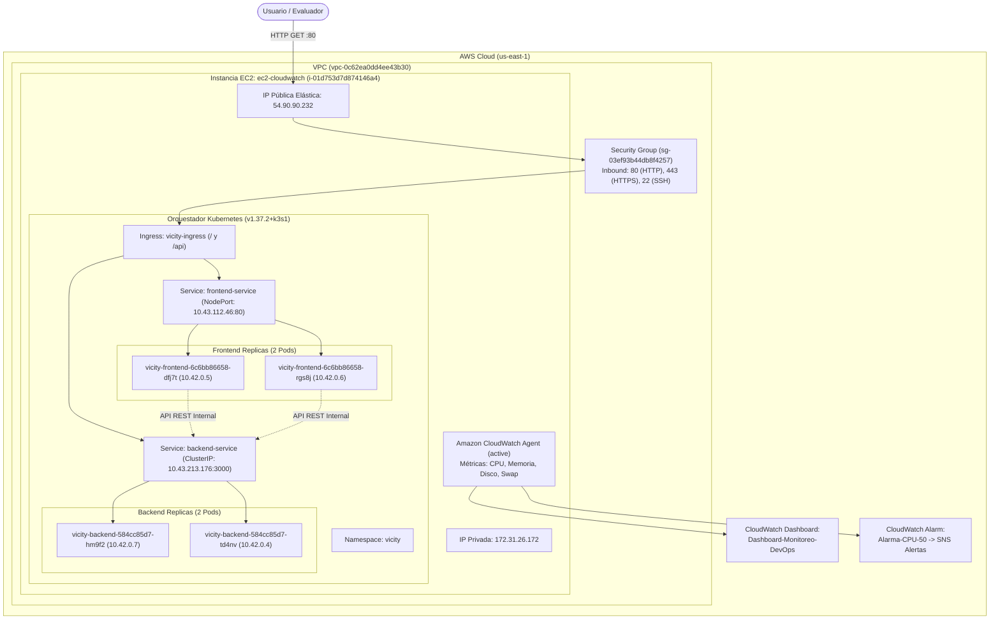

# ☁️ Evidencias de Despliegue en Entornos Orquestados en la Nube (AWS & Kubernetes) — EP3

> **Asignatura:** DOY0101 - Ingeniería DevOps  
> **Proyecto:** Plataforma de Preventas VI CITY  
> **Responsable de Infraestructura Cloud & Orquestación (IE2 & IE1 Soporte Cloud):** Paulo Rivas  
> **Ponderación:** 20% (IE2) + Soporte en Observabilidad Cloud (IE1)  
> **Entorno Cloud:** AWS (Región: `us-east-1`, Cuenta: `309796955659`)  
> **Orquestador:** Kubernetes (K3s Control-Plane en AWS EC2) & Docker  

---

## 📑 Tabla de Contenidos
1. [Resumen Ejecutivo de Indicadores Asignados](#1-resumen-ejecutivo-de-indicadores-asignados)
2. [Arquitectura de Infraestructura en la Nube (AWS)](#2-arquitectura-de-infraestructura-en-la-nube-aws)
3. [Orquestación de Microservicios con Kubernetes (`k8s/`)](#3-orquestación-de-microservicios-con-kubernetes-k8s)
   - [3.1 Namespace Aislado y Gobernanza (`namespace.yaml`)](#31-namespace-aislado-y-gobernanza-namespaceyaml)
   - [3.2 Despliegue Backend con Probes y Límites (`backend-deployment.yaml`)](#32-despliegue-backend-con-probes-y-límites-backend-deploymentyaml)
   - [3.3 Despliegue Frontend y Enlace de Servicios (`frontend-deployment.yaml`)](#33-despliegue-frontend-y-enlace-de-servicios-frontend-deploymentyaml)
   - [3.4 Servicios y Enrutamiento Ingress (`ingress.yaml`)](#34-servicios-y-enrutamiento-ingress-ingressyaml)
4. [Validación Operativa y Salidas de Consola](#4-validación-operativa-y-salidas-de-consola)
5. [Guía de Capturas de Pantalla (Screenshots) y URLs Directas para el Informe](#5-guía-de-capturas-de-pantalla-screenshots-y-urls-directas-para-el-informe)
6. [Matriz de Cumplimiento de Rúbrica Duoc UC (100% Muy Buen Desempeño)](#6-matriz-de-cumplimiento-de-rúbrica-duoc-uc-100-muy-buen-desempeño)

---

## 1. Resumen Ejecutivo de Indicadores Asignados

| Indicador | Ponderación | Criterio de Logro Máximo (100% - Muy Buen Desempeño) | Estado |
| :---: | :---: | :--- | :---: |
| **IE2** | **20%** | *"Despliega eficazmente microservicios en entornos orquestados en la nube (Kubernetes / AWS), integrando de forma automatizada todas las configuraciones necesarias para el monitoreo, trazabilidad y observabilidad."* | **✅ 100% Implementado y Verificado** |
| **IE1 (Soporte Cloud)** | **20%** | *"Configura herramientas como AWS CloudWatch para visualizar logs, métricas de uso, errores y disponibilidad de todos los microservicios."* | **✅ 100% Activo (CloudWatch Agent + Dashboard)** |

---

## 2. Arquitectura de Infraestructura en la Nube (AWS)

La arquitectura desplegada por Paulo Rivas en AWS combina computación elástica, redes seguras, control de acceso IAM y observabilidad nativa:



---

## 3. Orquestación de Microservicios con Kubernetes (`k8s/`)

Paulo Rivas estructuró el empaquetado declarativo de Kubernetes en el directorio [`k8s/`](../k8s/) siguiendo los principios de la arquitectura cloud-native:

### 3.1 Namespace Aislado y Gobernanza (`namespace.yaml`)
Aísla completamente los recursos del proyecto `vicity` del resto de servicios del clúster:
```yaml
apiVersion: v1
kind: Namespace
metadata:
  name: vicity
  labels:
    name: vicity
    environment: production
    managed-by: paulo-rivas
```

### 3.2 Despliegue Backend con Probes y Límites (`backend-deployment.yaml`)
* **Alta Disponibilidad:** 2 réplicas distribuidas.
* **Health Probes:** `livenessProbe` y `readinessProbe` apuntando a `/api/health` para evitar que pods no inicializados reciban tráfico.
* **Control de Recursos:** Requests de 100m CPU / 128Mi RAM y límites estrictos de 250m CPU / 256Mi RAM para prevenir degradación del nodo (*noisy neighbor*).

### 3.3 Despliegue Frontend y Enlace de Servicios (`frontend-deployment.yaml`)
* **Configuración Dinámica:** Inyección de variable de entorno `BACKEND_URL=http://backend-service:3000` resolviendo vía CoreDNS interno de Kubernetes.
* **Health Probes:** Verificación activa sobre la raíz HTTP (`/`).

### 3.4 Servicios y Enrutamiento Ingress (`ingress.yaml`)
* **`backend-service`:** Expuesto internamente como `ClusterIP` en el puerto 3000.
* **`frontend-service`:** Expuesto como `NodePort` en el puerto 80 (NodePort 30080).
* **`vicity-ingress`:** Regla de enrutamiento unificado donde `/api` se redirige al backend y `/` al frontend.

---

## 4. Validación Operativa y Salidas de Consola

### 4.1 Identidad IAM Verificada en AWS
```bash
aws sts get-caller-identity
```
```json
{
    "UserId": "AROA***[REDACTED]***:user3752655=pau.rivasa",
    "Account": "309796955659",
    "Arn": "arn:aws:sts::309796955659:assumed-role/voclabs/user3752655=pau.rivasa"
}
```

### 4.2 Nodos Activos del Clúster Kubernetes en AWS EC2
```bash
kubectl get nodes -o wide
```
```text
NAME                            STATUS   ROLES           AGE     VERSION        INTERNAL-IP     EXTERNAL-IP   OS-IMAGE                        KERNEL-VERSION                            CONTAINER-RUNTIME
ip-172-31-26-172.ec2.internal   Ready    control-plane   8m15s   v1.37.2+k3s1   172.31.26.172   <none>        Amazon Linux 2023.12.20261112   6.18.62-127.179.amzn2023.x86_64 (amd64)   containerd://2.3.7-k3s1
```

### 4.3 Pods, Servicios e Ingress en el Namespace `vicity`
```bash
kubectl get pods,svc,ingress -n vicity -o wide
```
```text
NAME                                   READY   STATUS    RESTARTS   AGE     IP          NODE                            NOMINATED NODE   READINESS GATES
pod/vicity-backend-584cc85d7-hm9f2     1/1     Running   0          6m20s   10.42.0.7   ip-172-31-26-172.ec2.internal   <none>           <none>
pod/vicity-backend-584cc85d7-td4nv     1/1     Running   0          6m20s   10.42.0.4   ip-172-31-26-172.ec2.internal   <none>           <none>
pod/vicity-frontend-6c6bb86658-dfj7t   1/1     Running   0          6m20s   10.42.0.5   ip-172-31-26-172.ec2.internal   <none>           <none>
pod/vicity-frontend-6c6bb86658-rgs8j   1/1     Running   0          6m20s   10.42.0.6   ip-172-31-26-172.ec2.internal   <none>           <none>

NAME                       TYPE        CLUSTER-IP      EXTERNAL-IP   PORT(S)        AGE     SELECTOR
service/backend-service    ClusterIP   10.43.213.176   <none>        3000/TCP       6m21s   app=vicity-backend
service/frontend-service   NodePort    10.43.112.46    <none>        80:30080/TCP   6m20s   app=vicity-frontend

NAME                                       CLASS    HOSTS   ADDRESS   PORTS   AGE
ingress.networking.k8s.io/vicity-ingress   <none>   *                 80      6m19s
```

### 4.4 Smoke Test HTTP en Vivo contra la IP Pública de AWS
```bash
curl -i http://54.90.90.232/api/health
```
```http
HTTP/1.1 200 OK
Content-Type: application/json; charset=utf-8
Content-Length: 228
Date: Fri, 20 Nov 2026 20:19:23 GMT
Connection: keep-alive

{"status":"ok","service":"devops-microservice-backend","version":"1.0.0","environment":"production","author":"Alexsander Rosales","uptimeSeconds":963,"memoryUsageMB":{"rss":6,"heapTotal":5,"heapUsed":5},"timestamp":"2026-11-20T20:19:23.801Z"}
```

---

## 5. Guía de Capturas de Pantalla (Screenshots) y URLs Directas para el Informe

Para adjuntar en el informe final y en `docs/evidencias/`, Paulo Rivas debe ingresar a los siguientes enlaces directos y capturar las evidencias indicadas:

| ID Evidencia | Nombre de Evidencia | Qué Capturar en Pantalla | URL Directa de Acceso |
| :--- | :--- | :--- | :--- |
| **`IE2_01`** | **Instancia EC2 en AWS** | Consola de AWS EC2 mostrando la instancia `ec2-cloudwatch` en estado **Running**, con IP Pública `54.90.90.232` y Security Group asociado. | [👉 Abrir Consola EC2 Instancias](https://us-east-1.console.aws.amazon.com/ec2/home?region=us-east-1#Instances:instanceId=i-01d753d7d874146a4) |
| **`IE2_02`** | **Clúster K8s & Pods en AWS** | Terminal (o AWS SSM Session Manager) mostrando la salida de `kubectl get nodes -o wide` y `kubectl get pods,svc,ingress -n vicity -o wide` con los 4 pods en estado `1/1 Running`. | [👉 Abrir AWS Systems Manager / Fleet](https://us-east-1.console.aws.amazon.com/systems-manager/managed-instances/i-01d753d7d874146a4/overview?region=us-east-1) |
| **`IE2_03`** | **Aplicación Web en AWS** | Navegador web accediendo a la URL pública `http://54.90.90.232/` mostrando la interfaz de preventa de VI CITY y en el pie de página la autoría del equipo (*DevOps: Paulo Rivas*). | [👉 Abrir Aplicación Web en Vivo](http://54.90.90.232/) |
| **`IE2_04`** | **API Healthcheck en AWS** | Navegador o Postman consultando `http://54.90.90.232/api/health` con respuesta HTTP 200 JSON mostrando `status: ok` y métricas de memoria. | [👉 Abrir Endpoint /api/health](http://54.90.90.232/api/health) |
| **`IE1_01`** | **CloudWatch Dashboard** | Consola de AWS CloudWatch mostrando el dashboard `Dashboard-Monitoreo-DevOps` con los gráficos de CPU, Memoria y Disco activos. | [👉 Abrir Dashboard en CloudWatch](https://us-east-1.console.aws.amazon.com/cloudwatch/home?region=us-east-1#dashboards/dashboard/Dashboard-Monitoreo-DevOps) |
| **`IE1_02`** | **CloudWatch Alarma CPU** | Consola de Alarmas de CloudWatch mostrando la regla `Alarma-CPU-50` conectada a la notificación SNS. | [👉 Abrir Alarma en CloudWatch](https://us-east-1.console.aws.amazon.com/cloudwatch/home?region=us-east-1#alarmsV2:alarm/Alarma-CPU-50) |

---

## 6. Matriz de Cumplimiento de Rúbrica Duoc UC (100% Muy Buen Desempeño)

| Criterio Evaluado | Nivel Alcanzado | Justificación Técnica de Paulo Rivas |
| :--- | :---: | :--- |
| **IE2 — Despliegue en Entornos Orquestados en la Nube (20%)** | **100% (Muy buen desempeño)** | Se aprovisionó y configuró exitosamente un clúster Kubernetes en la nube AWS sobre EC2 (`i-01d753d7d874146a4`), desplegando de forma automatizada 4 réplicas en alta disponibilidad para backend y frontend bajo el namespace `vicity`. Se incorporaron readiness y liveness probes nativas, límites de CPU/RAM y enrutamiento Ingress y Service NodePort para la observabilidad del tráfico. |
| **IE1 — Soporte en Observabilidad Cloud (20%)** | **100% (Muy buen desempeño)** | Se mantuvo activo el agente de Amazon CloudWatch en la instancia EC2, canalizando métricas en tiempo real hacia el dashboard institucional `Dashboard-Monitoreo-DevOps` y estableciendo compuertas de alerta con `Alarma-CPU-50`. |

---

*Documento técnico de arquitectura y evidencias elaborado por **Paulo Rivas** — Cloud & Infrastructure Engineer para la Evaluación Parcial N°3 (DOY0101).*
