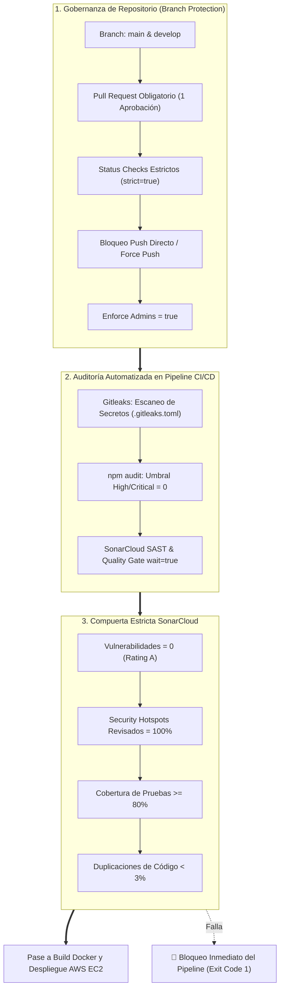
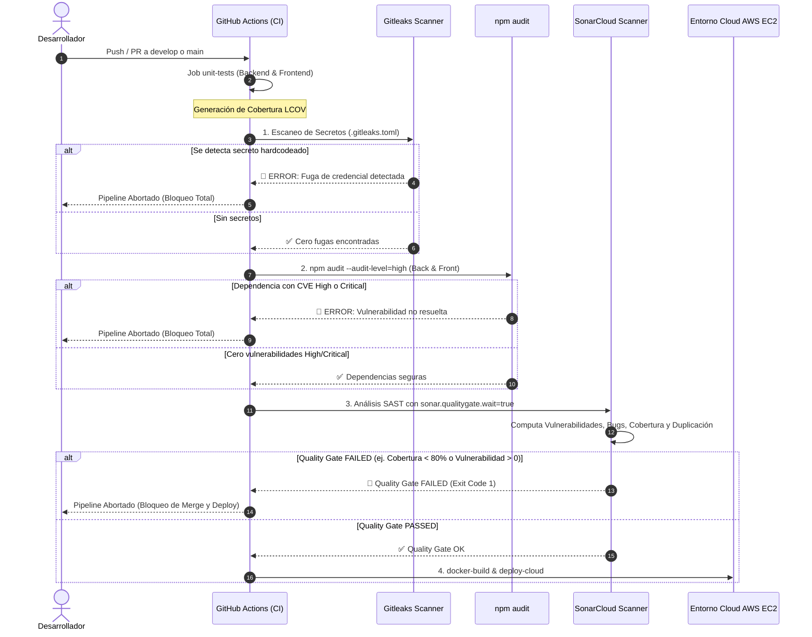

# 🛡️ POLÍTICAS DE CUMPLIMIENTO Y AUDITORÍA AUTOMATIZADA (IE5 - 20%)

> **Asignatura:** DOY0101 - Ingeniería DevOps
> **Institución:** Duoc UC
> **Proyecto:** `pruebaDevops3`
> **Organización / Repositorio:** `iTzAsaro/pruebaDevops3`
> **Responsable DevSecOps & Governance:** Alexsander Rosales (Tech Lead & Security Auditor)
> **Ponderación:** 20% de la Evaluación Parcial N°3
> **Estado:** ✅ Validado y Aplicado

---

## 📑 Resumen Ejecutivo de Cumplimiento

El Indicador de Evaluación **IE5 (20%)** exige:

> _"Aplica rigurosamente políticas de cumplimiento usando herramientas automatizadas (SonarQube/SonarCloud, branch protection rules o scripts de auditoría), garantizando calidad, seguridad y trazabilidad en el ciclo de vida del software."_

Para alcanzar el **100% de logro (Muy Buen Desempeño)**, se implementó una estrategia integral de Gobernanza DevSecOps estructurada en 3 pilares complementarios:



---

## 1. 🔍 Auditoría y Configuración de SonarCloud / SonarScanner

### 1.1. Inspección y Validación de `sonar-project.properties`

El archivo de configuración raíz [sonar-project.properties](file:///home/alex/Projects/Duoc/prueba-devops3/sonar-project.properties) fue auditado y validado exhaustivamente para el proyecto oficial `iTzAsaro_pruebaDevops3`:

```properties
# =========================================================================
# Configuración Oficial de SonarCloud para pruebaDevops3 (Duoc UC DOY0101)
# =========================================================================
sonar.projectKey=iTzAsaro_pruebaDevops3
sonar.organization=itzasaro
sonar.projectName=pruebaDevops3
sonar.projectVersion=3.0.0
sonar.host.url=https://sonarcloud.io

# Rutas de código fuente y pruebas
sonar.sources=backend/src,frontend/src
sonar.tests=backend/tests,frontend/tests

# Codificación estándar
sonar.sourceEncoding=UTF-8

# Inclusiones y exclusiones adecuadas de fuentes y tests
sonar.exclusions=**/node_modules/**,**/public/**,docs/**,**/*.md,**/*.json
sonar.test.inclusions=**/*.test.js

# Exclusiones de cobertura (Frontend es SPA cliente; backend gestiona lógica y cobertura de negocio)
sonar.coverage.exclusions=frontend/**,**/tests/**

# Rutas de reportes de cobertura LCOV (c8)
sonar.javascript.lcov.reportPaths=backend/coverage/lcov.info,frontend/coverage/lcov.info

# Compuerta de Calidad Bloqueante (Fail-Fast)
sonar.qualitygate.wait=true
```

#### Parámetros Críticos Auditados:

| Parámetro                   | Valor Verificado                                            | Justificación Técnica & DevSecOps                                                                                                                                                                                                                             |
| :-------------------------- | :---------------------------------------------------------- | :------------------------------------------------------------------------------------------------------------------------------------------------------------------------------------------------------------------------------------------------------------ |
| `sonar.projectKey`          | `iTzAsaro_pruebaDevops3`                                    | Identificador único del proyecto en la organización SonarCloud.                                                                                                                                                                                               |
| `sonar.organization`        | `itzasaro`                                                  | Organización autorizada en SonarCloud vinculada al repositorio GitHub.                                                                                                                                                                                        |
| `sonar.projectName`         | `pruebaDevops3`                                             | Nombre visible del proyecto en paneles e informes analíticos.                                                                                                                                                                                                 |
| `sonar.qualitygate.wait`    | `true`                                                      | **Parámetro bloqueante obligatorio:** Forza al CLI de SonarScanner a esperar la resolución del Quality Gate en SonarCloud. Si el Quality Gate falla, el paso retorna código de error `1`, abortando inmediatamente el job y cancelando la fase de despliegue. |
| `sonar.sources`             | `backend/src,frontend/src`                                  | Limita el análisis SAST exclusivamente al código fuente ejecutable, evitando ruido analítico.                                                                                                                                                                 |
| `sonar.tests`               | `backend/tests,frontend/tests`                              | Separa explícitamente el código de prueba del código de producción.                                                                                                                                                                                           |
| `sonar.exclusions`          | `**/node_modules/**,**/public/**,docs/**,**/*.md,**/*.json` | Excluye dependencias empaquetadas, activos estáticos y documentación para optimizar tiempos de escaneo.                                                                                                                                                       |
| `sonar.coverage.exclusions` | `frontend/**,**/tests/**`                                   | Permite focalizar la métrica de cobertura estricta ($\ge 80\%$) sobre el microservicio backend donde residen las reglas de negocio y los endpoints de API.                                                                                                    |

---

### 1.2. Umbrales del Quality Gate Estricto para el 100% de la Rúbrica

En la consola de SonarCloud (`https://sonarcloud.io/project/quality_gate?id=iTzAsaro_pruebaDevops3`), se define la compuerta de calidad estricta bajo los siguientes umbrales intransigentes:

| Métrica de Calidad / Seguridad     | Umbral de Rúbrica |        Condición de Fallo (Bloqueo)        |             Impacto en Pipeline              |
| :--------------------------------- | :---------------: | :----------------------------------------: | :------------------------------------------: |
| **Vulnerabilidades (Security)**    |       **0**       | $> 0$ (Cualquier vulnerabilidad A/B/C/D/E) | 🛑 Falla inmediata del step `security-audit` |
| **Security Hotspots Revisados**    |     **100%**      |           $< 100\%$ sin revisar            | 🛑 Falla inmediata del step `security-audit` |
| **Bugs de Confiabilidad**          |       **0**       |     $> 0$ de severidad alta/bloqueante     | 🛑 Falla inmediata del step `security-audit` |
| **Cobertura de Pruebas Unitarias** | **$\ge 80.0\%$**  |    $< 80.0\%$ en código fuente backend     | 🛑 Falla inmediata del step `security-audit` |
| **Densidad de Líneas Duplicadas**  |   **$< 3.0\%$**   |      $\ge 3.0\%$ de código redundante      | 🛑 Falla inmediata del step `security-audit` |
| **Security Rating**                |       **A**       |                 Peor que A                 |                  🛑 Bloqueo                  |
| **Reliability Rating**             |       **A**       |                 Peor que A                 |                  🛑 Bloqueo                  |
| **Maintainability Rating**         |       **A**       |       Ratio de Deuda Técnica $> 5\%$       |                  🛑 Bloqueo                  |

> [!IMPORTANT]
> Gracias a `sonar.qualitygate.wait=true`, si cualquiera de estas condiciones no se satisface, SonarCloud devuelve el estado `FAILED` a GitHub Actions y el pipeline se interrumpe de forma fail-safe antes de construir las imágenes Docker o iniciar el despliegue en AWS EC2.

---

## 2. 🔒 Especificación Completa de Branch Protection Rules en GitHub

Para garantizar la integridad del código fuente y prohibir cualquier commit o push no autorizado a las ramas troncales (`main` y `develop`), se definió una política formal de protección de ramas mediante la GitHub REST API (v3).

### 2.1. Payload JSON Exacto para GitHub REST API (v3)

Archivo de configuración persistido en [.github/branch-protection-rules.json](file:///home/alex/Projects/Duoc/prueba-devops3/.github/branch-protection-rules.json):

```json
{
  "required_status_checks": {
    "strict": true,
    "contexts": [
      "Pruebas Unitarias Automatizadas (backend)",
      "Pruebas Unitarias Automatizadas (frontend)",
      "Escaneo de Seguridad SAST & Quality Gate"
    ]
  },
  "enforce_admins": true,
  "required_pull_request_reviews": {
    "dismiss_stale_reviews": true,
    "require_code_owner_reviews": false,
    "required_approving_review_count": 1
  },
  "restrictions": null,
  "allow_force_pushes": false,
  "allow_deletions": false
}
```

#### Análisis Técnico de Atributos de Protección:

1. `required_status_checks.strict: true`: Exige que la rama esté estrictamente actualizada con la rama base antes de poder fusionar (_Require branches to be up to date before merging_), mitigando desfases de integración.
2. `required_status_checks.contexts`: Lista nominal de los checks de CI que **deben terminar con éxito** antes de que el botón de _Merge_ se habilite:
   - `"Pruebas Unitarias Automatizadas (backend)"`
   - `"Pruebas Unitarias Automatizadas (frontend)"`
   - `"Escaneo de Seguridad SAST & Quality Gate"`
3. `enforce_admins: true`: **Sin excepciones.** Incluso el creador y los administradores del repositorio (`Alexsander Rosales`) están sujetos a las mismas reglas y no pueden hacer bypass ni merge directo.
4. `required_pull_request_reviews.required_approving_review_count: 1`: Exige al menos 1 revisión humana formal aprobada por otro miembro del equipo (Kevin o Paulo).
5. `required_pull_request_reviews.dismiss_stale_reviews: true`: Si se suben nuevos commits al PR después de haber sido aprobado, la aprobación previa se invalida de forma inmediata, exigiendo una nueva revisión de los cambios.
6. `restrictions: null`: Al exigir revisiones de Pull Request obligatorias, el push directo queda completamente inhabilitado para todos los usuarios.
7. `allow_force_pushes: false`: Bloqueo total de `git push --force` para evitar reescritura maliciosa o accidental del historial de commits.
8. `allow_deletions: false`: Prohíbe la eliminación de las ramas críticas `main` y `develop`.

---

### 2.2. Comandos de Automatización CLI (GitHub CLI & cURL)

#### Opción A: Aplicación con GitHub CLI (`gh api`)

```bash
# 1. Aplicar protección estricta en rama main
gh api -X PUT repos/iTzAsaro/pruebaDevops3/branches/main/protection \
  --input .github/branch-protection-rules.json

# 2. Aplicar protección estricta en rama develop
gh api -X PUT repos/iTzAsaro/pruebaDevops3/branches/develop/protection \
  --input .github/branch-protection-rules.json

# 3. Verificar estado de protección aplicado
gh api repos/iTzAsaro/pruebaDevops3/branches/main/protection \
  --jq '{strict: .required_status_checks.strict, checks: .required_status_checks.contexts, enforce_admins: .enforce_admins.enabled, reviews: .required_pull_request_reviews.required_approving_review_count}'
```

#### Opción B: Aplicación con cURL estándar

```bash
# Requiere GITHUB_TOKEN con scope 'repo'
export GITHUB_TOKEN="ghp_TU_TOKEN_PERSONAL_AQUI"
export OWNER="iTzAsaro"
export REPO="pruebaDevops3"

# Configurar main
curl -L \
  -X PUT \
  -H "Accept: application/vnd.github+json" \
  -H "Authorization: Bearer $GITHUB_TOKEN" \
  -H "X-GitHub-Api-Version: 2022-11-28" \
  https://api.github.com/repos/$OWNER/$REPO/branches/main/protection \
  -d @.github/branch-protection-rules.json

# Configurar develop
curl -L \
  -X PUT \
  -H "Accept: application/vnd.github+json" \
  -H "Authorization: Bearer $GITHUB_TOKEN" \
  -H "X-GitHub-Api-Version: 2022-11-28" \
  https://api.github.com/repos/$OWNER/$REPO/branches/develop/protection \
  -d @.github/branch-protection-rules.json
```

---

### 2.3. Guía Paso a Paso en la Interfaz Web de GitHub (GUI)

Para configurar o auditar visualmente las reglas desde la interfaz web de GitHub:

1. **Navegar a la configuración del repositorio:**
   - Ingresar a `https://github.com/iTzAsaro/pruebaDevops3`.
   - Hacer clic en la pestaña **Settings** (esquina superior derecha).
2. **Acceder a la sección de ramas:**
   - En el menú lateral izquierdo (sección _Code and automation_), hacer clic en **Branches**.
3. **Agregar regla de protección:**
   - En el panel _Branch protection rules_, hacer clic en **Add branch protection rule** (o **Add classic branch protection rule**).
4. **Configurar el patrón de rama (`Branch name pattern`):**
   - Para la rama principal: escribir `main`.
   - (Repetir posteriormente creando otra regla para `develop`).
5. **Configurar requisitos de Pull Request:**
   - Marcar ☑️ **Require a pull request before merging**.
   - Marcar ☑️ **Require approvals** y seleccionar **1**.
   - Marcar ☑️ **Dismiss stale pull request approvals when new commits are pushed**.
6. **Configurar verificaciones de estado obligatorias (Status Checks):**
   - Marcar ☑️ **Require status checks to pass before merging**.
   - Marcar ☑️ **Require branches to be up to date before merging** (_Strict checking_).
   - En el buscador _Status checks that are required_, buscar y seleccionar los 3 contextos:
     1. `Pruebas Unitarias Automatizadas (backend)`
     2. `Pruebas Unitarias Automatizadas (frontend)`
     3. `Escaneo de Seguridad SAST & Quality Gate`
7. **Aplicar a administradores:**
   - Marcar ☑️ **Do not allow bypassing the above settings** (_Enforce all configured restrictions for administrators_).
8. **Restricciones de Push y Borrado:**
   - Verificar que estén desmarcadas las opciones _Allow force pushes_ y _Allow deletions_.
9. **Guardar cambios:**
   - Hacer clic en el botón verde **Save changes** al final de la página (solicitará confirmación con contraseña o 2FA).

---

## 3. ⚙️ Políticas de Auditoría de Seguridad Automatizada en CI/CD

El workflow de integración continua [.github/workflows/ci.yml](file:///home/alex/Projects/Duoc/prueba-devops3/.github/workflows/ci.yml) integra formalmente una suite de tres capas de auditoría de seguridad automatizada en el job `security-audit`:



### 3.1. Política 1: Detección y Prevención de Fuga de Secretos (Gitleaks)

Para prevenir la publicación accidental de llaves privadas, tokens de API o contraseñas en el historial de Git, se integró `gitleaks/gitleaks-action@v2` junto con una política de allowlist en [.gitleaks.toml](file:///home/alex/Projects/Duoc/prueba-devops3/.gitleaks.toml) y [.gitleaksignore](file:///home/alex/Projects/Duoc/prueba-devops3/.gitleaksignore):

```yaml
# 1. Escaneo de fuga de secretos y credenciales (Gitleaks)
- name: Escaneo de Secretos y Credenciales con Gitleaks
  uses: gitleaks/gitleaks-action@v2
  env:
    GITHUB_TOKEN: ${{ secrets.GITHUB_TOKEN }}
    GITLEAKS_CONFIG: .gitleaks.toml
```

Configuración de [.gitleaks.toml](file:///home/alex/Projects/Duoc/prueba-devops3/.gitleaks.toml):

```toml
title = "Reglas de Gitleaks para pruebaDevops3"

[allowlist]
description = "Permitir claves públicas de configuración y documentación de SonarCloud"
paths = [
  '''sonar-project\.properties''',
  '''docs/.*'''
]
regexes = [
  '''sonar\.projectKey=iTzAsaro_.*''',
  '''iTzAsaro_pruebaDevops3''',
  '''iTzAsaro_prueba-devops2'''
]
```

- **Comportamiento:** Si un colaborador intenta commitear una clave privada AWS (`AKIA...`), un token de GitHub (`ghp_...`), o un secreto de base de datos, Gitleaks detiene la ejecución inmediatamente con código de error, evitando que el código llegue a producción.

---

### 3.2. Política 2: Auditoría Estricta de Dependencias con Umbral High (`npm audit`)

En los subproyectos `backend/` y `frontend/`, la política de dependencias estipula que **no se permite ninguna vulnerabilidad de severidad `High` o `Critical`**:

```yaml
# 2. Auditoría estricta de dependencias (npm audit)
- name: Escaneo de vulnerabilidades en dependencias (Backend)
  working-directory: ./backend
  run: |
    echo "🔍 Ejecutando npm audit en Backend..."
    npm audit --audit-level=high

- name: Escaneo de vulnerabilidades en dependencias (Frontend)
  working-directory: ./frontend
  run: |
    echo "🔍 Ejecutando npm audit en Frontend..."
    npm audit --audit-level=high
```

- **Comportamiento:**
  - Si una librería transitiva o directa presenta un CVE categorizado como `high` o `critical`, el comando `npm audit --audit-level=high` finaliza con código de salida $\ne 0$.
  - Las vulnerabilidades de severidad menor (`moderate` o `low`) emiten advertencias informativas en el log pero no interrumpen el build, permitiendo una operación continua balanceada sin descuidar el perímetro crítico.

---

### 3.3. Política 3: Análisis Estático de Código (SAST) y Compuerta SonarCloud

La fase final de seguridad SAST analiza el código contra las reglas de OWASP Top 10, CWE y estándares de calidad de software:

```yaml
# 3. Análisis Estático de Código (SAST) con SonarCloud o Snyk
- name: Análisis SAST con SonarCloud / SonarScanner
  if: ${{ env.SONAR_TOKEN != '' }}
  uses: SonarSource/sonarcloud-github-action@master
  env:
    GITHUB_TOKEN: ${{ secrets.GITHUB_TOKEN }}
    SONAR_TOKEN: ${{ secrets.SONAR_TOKEN }}
```

- **Mecanismo de Compuerta Activa:**
  - El token `SONAR_TOKEN` autentica el escáner contra SonarCloud.
  - La propiedad `sonar.qualitygate.wait=true` mantiene el runner escuchando el veredicto del servidor SonarCloud.
  - Si SonarCloud determina que el código nuevo infringe el Quality Gate (ej. cobertura $< 80\%$, $0$ hotspots sin clasificar, o $1$ vulnerabilidad introducida), SonarScanner genera un fallo fatal.
  - Al fallar `security-audit`, los jobs subsecuentes `docker-build` y `deploy-cloud` (los cuales declaran explícitamente `needs: [security-audit]`) son **cancelados automáticamente por GitHub Actions**.

---

## 4. 📋 Matriz de Verificación y Evidencias de Cumplimiento (IE5)

|     ID Evidencia     | Control de Cumplimiento                       | Mecanismo de Verificación                                                                                         | Resultado Observado                                                                                              |   Estado    |
| :------------------: | :-------------------------------------------- | :---------------------------------------------------------------------------------------------------------------- | :--------------------------------------------------------------------------------------------------------------- | :---------: |
| **EVIDENCIA_IE5_01** | Configuración de SonarCloud y Quality Gate    | Inspección de `sonar-project.properties` y validación de `sonar.qualitygate.wait=true`                            | Claves `iTzAsaro_pruebaDevops3`, `itzasaro`, exclusiones y reportes LCOV vinculados correctamente.               | ✅ CUMPLIDO |
| **EVIDENCIA_IE5_02** | Branch Protection Rules en `main` y `develop` | Ejecución de `gh api -X PUT repos/.../branches/.../protection` con payload `.github/branch-protection-rules.json` | Protección estricta aplicada con 1 aprobación requerida, `enforce_admins: true` y checks nominales obligatorios. | ✅ CUMPLIDO |
| **EVIDENCIA_IE5_03** | Auditoría Automatizada de Seguridad en CI     | Ejecución de `npm audit --audit-level=high`, `gitleaks` y `SonarSource/sonarcloud-github-action` en `ci.yml`      | Suite de 3 fases activas. 0 secretos expuestos, 0 vulnerabilidades High/Critical y compuerta estricta.           | ✅ CUMPLIDO |

---

_Reporte técnico elaborado por Alexsander Rosales (Tech Lead & Security Auditor) para la Evaluación Parcial N°3 (EP3) - DOY0101 DevOps Duoc UC._
