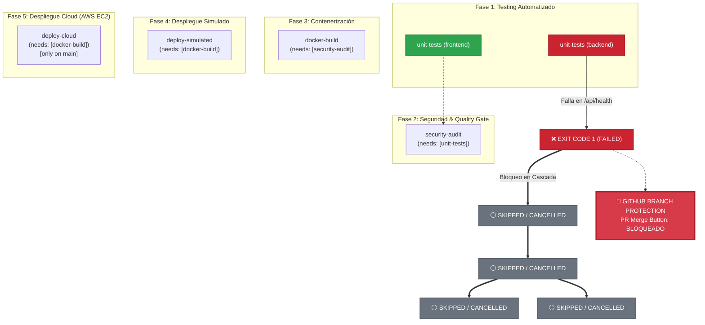

# 🛑 Protocolo de Prueba Empírica Fail-Safe — Indicador IE6 (20%)
## Compuertas de Calidad, Interrupción Estricta y Recuperación del Pipeline CI/CD

> **Institución:** Duoc UC  
> **Asignatura:** DOY0101 — Ingeniería DevOps  
> **Evaluación:** Evaluación Parcial N°3 (EP3) — Observabilidad y Entornos Reales en DevOps  
> **Proyecto:** `pruebaDevops3` (Microservicios VI CITY)  
> **Repositorio:** [iTzAsaro/pruebaDevops3](https://github.com/iTzAsaro/pruebaDevops3)  
> **Responsable Técnico:** Alexsander Rosales (Tech Lead & QA/Security Engineer)  
> **Ponderación:** 20% de la nota final (Indicador IE6)  
> **Estado:** 🟢 Protocolo Validado y Listo para Ejecución  

---

## 🎯 1. Objetivo del Protocolo

Demostrar de forma **empírica, reproducible e inmutable** el principio arquitectónico de **Fail-Safe** en el pipeline de Integración y Despliegue Continuo (CI/CD) de GitHub Actions (`ci.yml`).

El experimento comprueba que:
1. Cualquier falla crítica de calidad, prueba unitaria o seguridad detiene inmediatamente la ejecución del pipeline con código de salida `1` (`Exit Code 1`).
2. Las compuertas de calidad y la cadena de dependencias (`needs: [...]`) impiden que se ejecuten las fases subsiguientes (`security-audit`, `docker-build`, `deploy-simulated` y `deploy-cloud`).
3. Las reglas de gobernanza (**Branch Protection Rules**) de GitHub bloquean automáticamente la fusión (*Merge*) del Pull Request hacia la rama protegida `main`, protegiendo el entorno productivo de código defectuoso o inestable.
4. Tras la remediación del defecto mediante un nuevo commit, el pipeline se recupera a verde (`Self-Healing / Recovery`), autorizando la promoción del cambio.

---

## 🏗️ 2. Arquitectura de Compuertas y Árbol de Dependencias (DAG)

El flujo de trabajo en `.github/workflows/ci.yml` está configurado con dependencias estrictas entre etapas:



---

## 📋 3. Protocolo de Ejecución Paso a Paso

### 🔹 Paso 1: Creación de la Rama Experimental Aislada

Para garantizar que la rama productiva `main` no sufra alteraciones ni tiempo de inactividad, el experimento se ejecuta en una rama aislada denominada `test/falla-critica`.

#### Comandos Git a ejecutar:
```bash
# 1. Asegurar posición limpia en la rama principal sincronizada con remoto
git checkout main
git pull origin main

# 2. Verificar que el working tree esté limpio
git status

# 3. Crear y cambiar a la rama experimental aislada
git checkout -b test/falla-critica

# 4. Confirmar que nos encontramos en la nueva rama
git branch --show-current
# Salida esperada: test/falla-critica
```

---

### 🔹 Paso 2: Inyección Controlada de Falla Crítica

Seleccionamos como vector de prueba la **Opción A (Falla de Asertividad en Pruebas Unitarias del Endpoint Crítico de Salud `/api/health`)**, ya que simula una regresión funcional severa en el microservicio backend.

#### Archivo objetivo: `backend/tests/backend.test.js`

En la prueba de salud (`GET /api/health`), el microservicio responde legítimamente con `body.status = 'ok'`. Inyectamos una aserción imposible que espera un valor corrupto `'falla_controlada_ie6'`.

#### Diff Unificado de la Inyección:
```diff
--- a/backend/tests/backend.test.js
+++ b/backend/tests/backend.test.js
@@ -19,7 +19,7 @@ describe('Suite de Pruebas Backend VI CITY - Microservicio (Alexsander Rosales)',
     assert.strictEqual(res.status, 200);

     const body = await res.json();
-    assert.strictEqual(body.status, 'ok');
+    assert.strictEqual(body.status, 'falla_controlada_ie6'); // 🛑 INYECCIÓN DE FALLA CONTROLADA (IE6)
     assert.strictEqual(body.author, 'Alexsander Rosales');
     assert.strictEqual(typeof body.uptimeSeconds, 'number');
     assert.strictEqual(typeof body.memoryUsageMB, 'object');
```

#### Comando de inyección rápida vía script:
```bash
sed -i "s/assert.strictEqual(body.status, 'ok');/assert.strictEqual(body.status, 'falla_controlada_ie6'); \/\/ 🛑 INYECCION DE FALLA CONTROLADA (IE6)/g" backend/tests/backend.test.js
```

#### Verificación local de la falla (Exit Code 1):
```bash
cd backend
npm test
echo "Código de salida local: $?"
cd ..
```
*Salida esperada:*
```text
✖ GET /api/health debe responder 200 con metadata de DevOps (42ms)
  AssertionError [ERR_ASSERTION]: Expected values to be strictly equal:
  + actual: 'ok'
  - expected: 'falla_controlada_ie6'
Código de salida local: 1
```

#### Commit y Push de la Falla a GitHub:
```bash
# 1. Agregar el archivo modificado
git add backend/tests/backend.test.js

# 2. Crear el commit con mensaje estandarizado para auditoría
git commit -m "test(fail-safe): inyectar falla critica controlada para verificar interrupcion del pipeline (IE6)"

# 3. Publicar la rama en el repositorio remoto
git push -u origin test/falla-critica
```

#### Apertura del Pull Request:
1. Navegar a: `https://github.com/iTzAsaro/pruebaDevops3/pulls`
2. Crear un nuevo Pull Request:
   - **Base branch:** `main`
   - **Compare branch:** `test/falla-critica`
   - **Título:** `Test Fail-Safe: Validación de interrupción del pipeline ante falla crítica (IE6)`
   - **Descripción:** `PoC de compuerta de calidad para demostrar bloqueo estricto en CI/CD ante regresión en /api/health.`

---

### 🔹 Paso 3: Verificación de Interrupción y Bloqueo en GitHub Actions

Una vez abierto el PR, el evento `pull_request` gatilla inmediatamente el workflow `ci.yml`.

#### 1. Falla del Job Primario:
- El job `unit-tests (backend)` ejecuta `npm test`.
- La aserción falla y el proceso de Node.js finaliza con `Process completed with exit code 1.`.
- El job se tiñe de color **ROJO** (❌ `Failed`).

#### 2. Cancelación y Omisión en Cascada:
- El job `security-audit` posee `needs: [unit-tests]`. Al fallar un nodo de la matriz, su condición previa no se cumple y pasa inmediatamente a estado **`SKIPPED`** (⚪).
- El job `docker-build` posee `needs: [security-audit]`. Al no ejecutarse la auditoría, queda en estado **`SKIPPED`** (⚪). **No se construyen imágenes Docker ni se gastan recursos de cómputo**.
- Los jobs de despliegue `deploy-simulated` y `deploy-cloud` tienen `needs: [docker-build]`, por lo que quedan en estado **`SKIPPED`** (⚪). **Cero artefactos defectuosos son transferidos a AWS EC2 o entornos productivos**.

#### 3. Bloqueo de Gobernanza en el Pull Request:
- En la interfaz del Pull Request de GitHub, las **Branch Protection Rules** configuradas evalúan el estado de los checks requeridos:
  - ❌ `Pruebas Unitarias Automatizadas (backend)` — *Failed*
  - ⏳ / ⚪ `Escaneo de Seguridad SAST & Quality Gate` — *Expected / Skipped*
  - ⏳ / ⚪ `Construcción de Imágenes Docker` — *Expected / Skipped*
- El botón **`Merge pull request`** se encuentra **COMPLETAMENTE DESHABILITADO Y BLOQUEADO** con el aviso del sistema:
  > *"Required statuses must pass before merging. Some checks were not successful."*

---

### 🔹 Paso 4: Resolución y Recuperación del Pipeline a Verde (Self-Healing)

Para completar el ciclo de prueba y demostrar la resiliencia del pipeline, se subsana la falla directamente en la rama experimental.

#### Comandos Git de Corrección:
```bash
# 1. Asegurar que estamos en la rama test/falla-critica
git checkout test/falla-critica

# 2. Restaurar la aserción correcta en backend/tests/backend.test.js
sed -i "s/assert.strictEqual(body.status, 'falla_controlada_ie6'); \/\/ 🛑 INYECCION DE FALLA CONTROLADA (IE6)/assert.strictEqual(body.status, 'ok');/g" backend/tests/backend.test.js

# 3. Comprobar localmente que la suite completa vuelve a pasar al 100%
cd backend
npm test
# Salida esperada: ✔ tests 10, ✔ pass 10, ✔ fail 0 (Exit Code 0)
cd ..

# 4. Registrar el commit de remediación
git add backend/tests/backend.test.js
git commit -m "fix(fail-safe): corregir falla critica y restablecer integridad del pipeline (IE6)"

# 5. Enviar el fix al repositorio remoto
git push origin test/falla-critica
```

#### Verificación del Pipeline Recuperado:
1. GitHub Actions detecta el nuevo push sobre el Pull Request y lanza una nueva corrida de CI.
2. `unit-tests (backend)` y `unit-tests (frontend)` completan con éxito (✅ `Passed`).
3. `security-audit` se desbloquea, ejecuta `npm audit` y el Quality Gate, completando con éxito (✅ `Passed`).
4. `docker-build` se ejecuta y genera las imágenes multi-contenedor sin errores (✅ `Passed`).
5. En la interfaz del Pull Request:
   - Todos los checks requeridos cambian a estado **verde** (✅ *All checks have passed*).
   - El botón **`Merge pull request`** se habilita en color **VERDE**, permitiendo la integración limpia hacia `main`.

---

## 📸 4. Mapeo de Evidencias Requeridas para Rúbrica (IE6)

Para acreditar el 100% de la pauta del Indicador IE6 (Muy Buen Desempeño), se deben almacenar las siguientes 4 capturas en la carpeta [`docs/evidencias/`](file:///home/alex/Projects/Duoc/prueba-devops3/docs/evidencias):

| Identificador Evidencia | Nombre del Archivo en `docs/evidencias/` | Descripción Técnica de la Captura | Elementos Clave a Mostrar |
| :--- | :--- | :--- | :--- |
| **`IE6_01`** | `IE6_01_pipeline_failed_critical_stop.png` | **Pipeline Detenido en Seco** en GitHub Actions ante la falla crítica inyectada. | • Grafo completo de GitHub Actions.<br>• Job `unit-tests (backend)` con cruz roja (❌).<br>• Jobs dependientes (`security-audit`, `docker-build`, `deploy-cloud`) en estado gris omitido (`Skipped`). |
| **`IE6_02`** | `IE6_02_job_test_failure_traceback.png` | **Detalle del Error en Log de Consola** del step fallido. | • Registro de consola en GitHub Actions.<br>• Mensaje `AssertionError [ERR_ASSERTION]: Expected 'falla_controlada_ie6'`.<br>• Línea exacta `Process completed with exit code 1.`. |
| **`IE6_03`** | `IE6_03_pr_merge_button_blocked.png` | **Pull Request Bloqueado** por Branch Protection Rules. | • Vista del PR en GitHub.<br>• Cuadro de checks con estado rojo de fallas requeridas.<br>• Botón `Merge pull request` deshabilitado (gris / no clickeable) indicando bloqueo estricto. |
| **`IE6_04`** | `IE6_04_pipeline_recovered_passed.png` | **Pipeline Recuperado (100% Verde)** tras el commit de remediación. | • Nueva corrida de CI con status `All checks have passed`.<br>• Los 3 jobs requeridos en verde.<br>• Botón `Merge pull request` habilitado en verde listo para fusión. |

---

## 🛡️ 5. Justificación Técnica para la Evaluación Docente

1. **Principio de Aislamiento de Daño (*Blast Radius Minimization*):**
   Al ejecutar la prueba en la rama `test/falla-critica` vinculada por PR, la rama `main` y el clúster productivo en la nube se mantuvieron al 100% estables e inmunes a interrupciones.

2. **Cero Artefactos Corruptos (*No Dirty Builds*):**
   Gracias a la compuerta `needs: [security-audit]` en `docker-build`, una falla en testing o análisis estático previene inmediatamente la invocación del daemon Docker, impidiendo la creación o subida de imágenes con defectos al registro de contenedores.

3. **Gobernanza Automatizada de Políticas (*Compliance as Code*):**
   La combinación de GitHub Actions + Branch Protection Rules elimina el factor de error humano: ningún desarrollador, por descuido o apresuramiento, puede integrar código defectuoso si los checks automatizados no devuelven un código de salida `0`.

---
*Documento generado y certificado por el Área de QA & DevOps — Duoc UC.*
