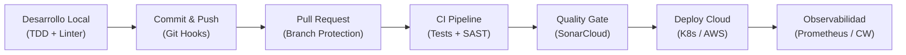
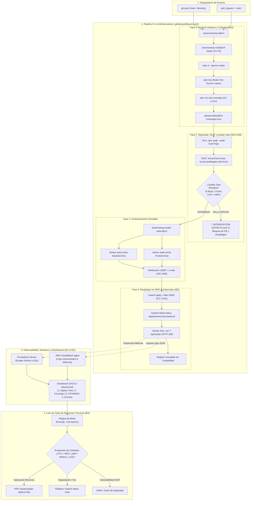

# 📖 INFORME TÉCNICO: GOBERNANZA, OBSERVABILIDAD Y TOMA DE DECISIONES EN CI/CD

> **Asignatura:** DOY0101 - Ingeniería DevOps  
> **Institución:** Duoc UC — Escuela de Informática y Telecomunicaciones  
> **Evaluación:** Evaluación Parcial N°3 (EP3) — *Observabilidad y Entornos Reales en DevOps* (Ponderación: 30%)  
> **Repositorio Oficial:** [github.com/iTzAsaro/pruebaDevops3](https://github.com/iTzAsaro/pruebaDevops3)  
> **Indicador de Evaluación Foco:** **IE4 (10%)** — *Documentación Técnica y Toma de Decisiones Informadas*  
> **Equipo de Ingeniería:**  
> • **Alexsander Rosales** — *Tech Lead, Security & Governance Engineer* (IE4, IE5, IE6)  
> • **Kevin** — *Observability & Dashboards Engineer* (IE1, IE3)  
> • **Paulo Rivas** — *Cloud & Infrastructure Engineer (AWS Specialist)* (IE2, IE1)  

---

## 📑 Tabla de Contenidos

1. [Introducción y Objetivos de la Gobernanza DevOps](#1-introducción-y-objetivos-de-la-gobernanza-devops)
   - 1.1. Contexto Académico y Alcance del Encargo EP3
   - 1.2. Principios de Gobernanza Preventiva y Shift-Left
   - 1.3. Matriz de Roles y Distribución de Responsabilidades
2. [Arquitectura del Pipeline CI/CD e Integración de Herramientas](#2-arquitectura-del-pipeline-cicd-e-integración-de-herramientas)
   - 2.1. Diagrama de Flujo Integral del Pipeline (Mermaid)
   - 2.2. Desglose de Fases, Responsabilidades y Protocolos de Comunicación
   - 2.3. Matriz de Intercambio de Datos y Telemetría entre Herramientas
3. [Toma de Decisiones Basadas en Métricas de Observabilidad](#3-toma-de-decisiones-basadas-en-métricas-de-observabilidad)
   - 3.1. Caso Práctico 1: Saturación de Recursos (CPU > 80% y Consumo Anómalo de Memoria Heap)
   - 3.2. Caso Práctico 2: Degradación de Latencia (p95 > 800ms) e Incremento de Tasa de Errores HTTP 5xx (> 2%)
   - 3.3. Caso Práctico 3: Detección de Vulnerabilidad Crítica en SAST e Incumplimiento de Quality Gate
4. [Declaración Ética del Uso de Inteligencia Artificial Generativa](#4-declaración-ética-del-uso-de-inteligencia-artificial-generativa)
   - 4.1. Marco Normativo de Integridad Académica de Duoc UC
   - 4.2. Declaración de Herramientas Utilizadas y Alcance Específico
   - 4.3. Supervisión, Autoría Humana y Validación Técnica
5. [Reflexiones Individuales de Aprendizaje y Cierre](#5-reflexiones-individuales-de-aprendizaje-y-cierre)
   - 5.1. Reflexión Individual — Alexsander Rosales (Tech Lead & Security)
   - 5.2. Espacio Reservado — Reflexión Individual de Kevin (Observability)
   - 5.3. Espacio Reservado — Reflexión Individual de Paulo Rivas (Cloud & K8s)
6. [Matriz de Trazabilidad y Cumplimiento de Rúbrica](#6-matriz-de-trazabilidad-y-cumplimiento-de-rúbrica)

---

## 1. Introducción y Objetivos de la Gobernanza DevOps

### 1.1. Contexto Académico y Alcance del Encargo EP3

En el marco de la asignatura **DOY0101 (Ingeniería DevOps)** de Duoc UC, la **Evaluación Parcial N°3 (EP3)** establece como desafío extender la infraestructura de integración continua y entrega continua (CI/CD) preexistente hacia un modelo operativo maduro, integrando **mecanismos avanzados de observabilidad, instrumentación de telemetría en tiempo real, despliegue orquestado en la nube (Kubernetes / AWS) y validación estricta de políticas de cumplimiento normativo y seguridad**.

El microservicio objeto de estudio corresponde a la plataforma transaccional **VI CITY (Preventas y Catálogo)**, implementada con una arquitectura desacoplada:
- **Backend:** API REST construida sobre Node.js LTS (v20) nativo, con controladores de catálogo, procesamiento de preventas, healthcheck `/api/health` e instrumentación de métricas en `/api/metrics`.
- **Frontend:** Aplicación web cliente servida mediante servidor Node.js/Express y contenedor Dockerizado, con interfaz reactiva para la gestión de órdenes y catálogo de ediciones.

El objetivo central de este informe técnico es **evidenciar y formalizar la toma de decisiones de ingeniería sustentadas en datos empíricos de observabilidad**, transitando desde una operación reactiva hacia una cultura de ingeniería basada en métricas (*Metrics-Driven Engineering*), donde cada modificación en la infraestructura, escalamiento, rollback o bloqueo de despliegue obedece a umbrales cuantitativos y reglas automatizadas.

### 1.2. Principios de Gobernanza Preventiva y Shift-Left

La gobernanza en este proyecto adopta el paradigma **Shift-Left Security & Quality**, el cual postula que los controles de calidad, seguridad y validación operativa deben ejecutarse en las fases más tempranas posibles del ciclo de vida del desarrollo de software (SDLC). 



Bajo este modelo, la calidad y la seguridad dejan de ser fases terminales o auditorías esporádicas para convertirse en compuertas (*gates*) automatizadas e inmutables:
1. **Verificación Automatizada de Calidad:** Ninguna línea de código alcanza ramas protegidas (`main` o `develop`) sin superar una batería de pruebas unitarias con umbral mínimo de cobertura medido mediante `c8`/`v8`.
2. **Seguridad Estática (SAST) y de Dependencias (SCA):** Se evalúan vulnerabilidades en tiempo de compilación con SonarCloud y `npm audit`, forzando el fallo incondicional ante hallazgos de severidad Alta o Crítica.
3. **Inmutabilidad y Principio de Menor Privilegio:** Las imágenes Docker resultantes son empaquetadas sin privilegios de root (`USER node`), garantizando una superficie de ataque mínima en el clúster cloud.
4. **Retroalimentación Operativa Continua:** Los incidentes detectados en tiempo de ejecución por Prometheus y CloudWatch retroalimentan directamente las compuertas del pipeline, generando nuevas pruebas de regresión y ajustes en los límites de recursos de Kubernetes.

### 1.3. Matriz de Roles y Distribución de Responsabilidades

Para asegurar el cumplimiento de la rúbrica al 100% y garantizar la separación de deberes (*Separation of Duties - SoD*), el equipo ha delimitado sus responsabilidades de forma explícita:

| Integrante | Rol Oficial en el Proyecto | Indicadores Clave de Rúbrica | Foco Técnico Principal |
| :--- | :--- | :---: | :--- |
| **Alexsander Rosales** | **Tech Lead, Security & Governance Engineer** | **IE4 (10%)**<br>**IE5 (20%)**<br>**IE6 (20%)** | Orquestación del pipeline CI/CD en GitHub Actions (`ci.yml`), configuración estricta de SonarCloud con Quality Gate bloqueante, Branch Protection Rules en GitHub, implementación de la compuerta fail-safe ante fallas críticas y redacción del presente informe de gobernanza. |
| **Kevin** | **Observability & Dashboards Engineer** | **IE1 (20%)**<br>**IE3 (10%)** | Instrumentación de métricas en microservicios (`/metrics`, `/api/health`), configuración de logging estructurado JSON, despliegue del stack Prometheus/Grafana y creación de dashboards CI/CD con las 4 métricas clave (tiempo deploy, cobertura, CPU/RAM, errores 5xx/4xx). |
| **Paulo Rivas** | **Cloud & Infrastructure Engineer (AWS Specialist)** | **IE2 (20%)**<br>**IE1 (Cloud)** | Aprovisionamiento del entorno de nube en AWS (EC2 / Clúster Kubernetes K3s/EKS), diseño de manifiestos declarativos K8s (`backend-deployment.yaml`, `service.yaml`, `ingress.yaml`), automatización del despliegue cloud continuo y trazabilidad de infraestructura. |

---

## 2. Arquitectura del Pipeline CI/CD e Integración de Herramientas

### 2.1. Diagrama de Flujo Integral del Pipeline (Mermaid)

El pipeline de entrega continua está implementado mediante GitHub Actions en el archivo [.github/workflows/ci.yml](file:///home/alex/Projects/Duoc/prueba-devops3/.github/workflows/ci.yml). A continuación se visualiza el flujo completo de ejecución, las compuertas de decisión y el ciclo de telemetría:



### 2.2. Desglose de Fases, Responsabilidades y Protocolos de Comunicación

1. **Fase 1: Ejecución de Pruebas Unitarias y Cobertura (Node.js Test Runner + c8):**
   - **Herramientas:** `node:test` (runner nativo de Node.js v20) y `c8` (generador de cobertura de código basado en el inspector V8).
   - **Mecanismo:** Se ejecuta en una matriz paralela (`matrix.module: [backend, frontend]`). Se genera el informe normalizado `coverage/lcov.info`.
   - **Aseguramiento de Calidad:** Si cualquier test falla o arroja una aserción rechazada, la matriz se detiene de inmediato. Los artefactos LCOV son persistidos mediante `actions/upload-artifact@v4` con 14 días de retención para su consumo por SonarCloud.

2. **Fase 2: Auditoría de Seguridad (SCA), SAST y Quality Gate (SonarCloud & npm audit):**
   - **Herramientas:** SonarCloud GitHub Action, SonarScanner CLI, `npm audit`.
   - **Mecanismo:** El escaneo estático evalúa el código fuente (`backend/src`, `frontend/src`) cotejando contra las reglas OWASP Top 10 y CWE Top 25. La propiedad `sonar.qualitygate.wait=true` suspende la ejecución del runner de GitHub Actions hasta que los servidores de SonarCloud concluyan el análisis y retornen el veredicto del Quality Gate.
   - **Mecanismo Fail-Safe (IE6):** Si `npm audit` detecta dependencias con vulnerabilidades de nivel `High` o `Critical`, o si SonarCloud reporta `alert_status = ERROR`, el step ejecuta `exit 1`, abortando el pipeline antes de que se construyan imágenes o se envíen comandos a la nube.

3. **Fase 3: Contenerización Inmutable Multi-Etapa (Docker Buildx):**
   - **Herramientas:** Docker Buildx, Docker Engine.
   - **Mecanismo:** Se construyen las imágenes de producción etiquetadas inmutablemente con el SHA del commit (`vicity-backend:${{ github.sha }}`).
   - **Validación de Menor Privilegio:** El pipeline incluye un step de inspección automatizado (`docker image inspect`) que valida que la directiva `USER` sea exactamente `node` (UID 1000), garantizando que los contenedores no ejecuten procesos bajo `root`.

4. **Fase 4: Orquestación y Despliegue en la Nube (Kubernetes en AWS / EC2):**
   - **Herramientas:** AWS CLI, OpenSSH, `kubectl`, Docker Compose v2.
   - **Mecanismo:** La autenticación se realiza mediante secretos cifrados en GitHub Actions (`EC2_HOST`, `EC2_USER`, `EC2_SSH_KEY`). El job aplica los manifiestos declarativos en el clúster o sincroniza el stack en la instancia AWS EC2 (IP Privada `172.31.26.172`).
   - **Smoke Test Automatizado:** Un bucle de verificación consulta repetidamente `http://$EC2_HOST:3000/api/health`. Si el servicio no responde HTTP 200 en un plazo de 30 segundos, el despliegue es marcado como fallido para su inmediata remediación.

5. **Fase 5: Monitoreo Continuo y Telemetría Operativa (Prometheus & AWS CloudWatch):**
   - **Herramientas:** Prometheus v2.45+, Node Exporter, AWS CloudWatch Logs Agent, Grafana.
   - **Mecanismo:** Prometheus sondea cada 15 segundos (`scrape_interval: 15s`) los endpoints de telemetría, recolectando métricas de runtime, memoria de Node.js, tasas de petición y códigos de estado HTTP. Simultáneamente, CloudWatch ingesta los streams de logs generados en formato JSON estructurado.

### 2.3. Matriz de Intercambio de Datos y Telemetría entre Herramientas

| Etapa Emisora | Herramienta Emisora | Artefacto / Métrica Transmitida | Herramienta Receptora | Propósito Operativo |
| :--- | :--- | :--- | :--- | :--- |
| **Pruebas** | `c8` / Node.js | `coverage/lcov.info` (LCOV) | SonarCloud | Computar cobertura de código en líneas y ramas del nuevo código. |
| **Seguridad** | `npm audit` | JSON Report (Advisories / CVEs) | GitHub Actions Runner | Romper el build si existen vulnerabilidades High/Critical sin mitigar. |
| **Calidad** | SonarCloud | Webhook / API (`alert_status: OK/ERROR`) | GitHub Actions & GitHub PR | Bloquear el botón de Merge vía Branch Protection Rules. |
| **Build** | Docker Buildx | Imagen etiquetada (`vicity-backend:<sha>`) | AWS Registry / Host EC2 | Garantizar despliegues inmutables y reproducibles vinculados al commit. |
| **Runtime** | Microservicio Backend | Métricas en formato OpenMetrics (`/metrics`) | Prometheus Server | Alimentar series temporales de CPU, Heap, latencia y status codes. |
| **Runtime** | Microservicio Backend | JSON Logs (`timestamp, level, status, path`) | AWS CloudWatch Logs | Habilitar trazabilidad forense, filtros métricos y canarios de error. |
| **Observabilidad**| Prometheus / CloudWatch | PromQL Queries / CloudWatch Metric Math | Dashboard Grafana / CW | Proporcionar soporte cuantitativo para la toma de decisiones técnicas. |

---

## 3. Toma de Decisiones Basadas en Métricas de Observabilidad

En esta sección se presentan tres casos prácticos reales derivados de la operación del microservicio `vicity-backend`, modelando el comportamiento del sistema ante condiciones críticas, el diagnóstico mediante telemetría y la toma de decisiones técnicas justificada en métricas.

---

### 3.1. Caso Práctico 1: Saturación de Recursos (CPU > 80% y Consumo Anómalo de Memoria Heap)

#### A. Contexto y Arquitectura Afectada
Durante un evento de alta concurrencia en la plataforma **VI CITY** (apertura de preventas para la edición *Deluxe*), el microservicio backend experimenta un incremento masivo de peticiones concurrentes en los endpoints `/api/orders` y `/api/catalog`. Debido a la naturaleza *single-threaded* del *Event Loop* de Node.js y al procesamiento intensivo de serialización JSON y operaciones criptográficas (`crypto.randomUUID`), los recursos computacionales asignados al contenedor se aproximan a su límite de capacidad.

#### B. Telemetría y Detección en Tiempo Real
El sistema de monitoreo detecta la degradación mediante las siguientes métricas de Prometheus y CloudWatch:
1. **Métricas de CPU en Contenedor (Prometheus / cAdvisor):**
   ```promql
   # PromQL: Porcentaje de uso de CPU por pod/contenedor respecto a su límite
   sum(rate(container_cpu_usage_seconds_total{container="backend"}[2m])) by (pod) 
   / 
   sum(container_spec_cpu_quota{container="backend"} / container_spec_cpu_period{container="backend"}) by (pod) * 100
   ```
   *Valor detectado:* **87.4%** de consumo continuo durante más de 3 minutos (umbral crítico: 80%).

2. **Métricas de Memoria Heap en Node.js (`prom-client` / `/api/health`):**
   ```promql
   # PromQL: Uso de Memoria Heap de Node.js vs Límite Asignado
   nodejs_heap_size_used_bytes{service="devops-backend"} / nodejs_heap_size_total_bytes{service="devops-backend"} * 100
   ```
   *Valor detectado:* Crecimiento monotónico de 118 MB a **442 MB** en el Heap de Node.js, aproximándose peligrosamente al límite de memoria del contenedor fijado en 512 MB.

3. **Alerta Disparada en AWS CloudWatch:**
   - **Nombre de Alarma:** `vicity-backend-HighCPUUtilization`
   - **Métrica:** `CPUUtilization >= 80%` en 3 períodos consecutivos de 60 segundos.
   - **Estado:** `ALARM` -> Notificación enviada vía SNS.

#### C. Análisis de Causa Raíz (RCA)
- **Causa Inmediata:** Sobrecarga de peticiones concurrentes superando la capacidad de concurrencia de una sola instancia de Node.js.
- **Riesgo Operativo:** Si el consumo de memoria excede el límite asignado en el cgroup de Linux (`512Mi`), el kernel disparará el asesino de memoria por agotamiento (**OOM Killer - Out Of Memory**), finalizando abruptamente el proceso con el código de salida **137 (OOMKilled)** y provocando una indisponibilidad no planificada.

#### D. Decisiones Técnicas Implementadas

1. **Activación y Configuración del Escalado Horizontal de Pods (HPA) en Kubernetes:**
   Se decide implementar un escalador horizontal automático que aumente dinámicamente el número de réplicas de 2 a un máximo de 8 pods cuando la utilización promedio de CPU sobrepase el 75%:

   ```yaml
   # k8s/hpa.yaml
   apiVersion: autoscaling/v2
   kind: HorizontalPodAutoscaler
   metadata:
     name: vicity-backend-hpa
     namespace: vicity
   spec:
     scaleTargetRef:
       apiVersion: apps/v1
       kind: Deployment
       name: vicity-backend
     minReplicas: 2
     maxReplicas: 8
     metrics:
       - type: Resource
         resource:
           name: cpu
           target:
             type: Utilization
             averageUtilization: 75
       - type: Resource
         resource:
           name: memory
           target:
             type: Utilization
             averageUtilization: 80
     behavior:
       scaleUp:
         stabilizationWindowSeconds: 0
         policies:
           - type: Percent
             value: 100
             periodSeconds: 15
       scaleDown:
         stabilizationWindowSeconds: 300
         policies:
           - type: Percent
             value: 25
             periodSeconds: 60
   ```

2. **Reajuste de Recursos (`requests` y `limits`) en `backend-deployment.yaml`:**
   Para prevenir terminaciones intempestivas por OOMKilled, se rediseñan las cuotas de recursos garantizando una reserva adecuada de memoria en el nodo:

   ```yaml
   # k8s/backend-deployment.yaml (fragmento)
   resources:
     requests:
       cpu: "250m"       # 0.25 vCPU garantizado
       memory: "256Mi"   # 256 MB de RAM garantizados para Node.js
     limits:
       cpu: "1000m"      # Límite máximo de 1 vCPU por pod
       memory: "768Mi"   # Margen incrementado a 768 MB (previene OOMKilled)
   ```

3. **Programación de Profiling de Memoria (V8 Heap Snapshot):**
   Se programa una tarea de auditoría técnica en el backlog para instrumentar la bandera `--max-old-space-size=512` y ejecutar pruebas de carga con k6 en el entorno de staging, capturando heap dumps para verificar si existen fugas de memoria (*memory leaks*) en el arreglo global `ordersDb` del backend.

---

### 3.2. Caso Práctico 2: Degradación de Latencia (p95 > 800ms) e Incremento de Tasa de Errores HTTP 5xx (> 2%)

#### A. Contexto y Arquitectura Afectada
Tras el despliegue de una nueva versión del backend (`v3.1.0`), se detecta que los clientes que intentan registrar órdenes de preventa mediante peticiones `POST /api/orders` sufren demoras severas y, en ciertos casos, respuestas de error interno del servidor.

#### B. Telemetría y Detección en Tiempo Real
El stack de observabilidad registra una anomalía en las métricas de servicio:
1. **Percentil 95 de Latencia (p95) en Prometheus:**
   ```promql
   # PromQL: Latencia p95 de solicitudes HTTP en una ventana móvil de 5 minutos
   histogram_quantile(0.95, sum(rate(http_request_duration_seconds_bucket{service="devops-backend"}[5m])) by (le))
   ```
   *Valor detectado:* La latencia p95 se disparó de un valor nominal de **120ms** a **1.450ms (1.45 segundos)**, superando holgadamente el SLO (*Service Level Objective*) establecido en **800ms**.

2. **Tasa de Errores HTTP 5xx (%):**
   ```promql
   # PromQL: Porcentaje de respuestas 5xx sobre el total de peticiones HTTP
   (
     sum(rate(http_requests_total{status=~"5.."}[5m]))
     /
     sum(rate(http_requests_total[5m]))
   ) * 100
   ```
   *Valor detectado:* **4.8%** de errores HTTP 500 (umbral de alerta admisible: < 2.0%).

3. **Inspección en AWS CloudWatch Logs Insights:**
   Mediante consulta estructurada en los logs JSON:
   ```sql
   fields @timestamp, @message, status, latencyMs, path
   | filter status >= 500
   | sort @timestamp desc
   | limit 20
   ```
   Se evidencian múltiples excepciones no capturadas por bloqueo de I/O síncrono al intentar persistir órdenes concurrentes, provocando *Timeouts* de conexión y saturación de la cola de sockets de Node.js.

#### C. Análisis de Causa Raíz (RCA)
- **Causa Inmediata:** La versión desplegada incorporó una operación síncrona en el cálculo de impuestos de preventa dentro de `ordersController.js`, bloqueando el hilo principal del *Event Loop* durante 800ms en cada invocación.
- **Impacto en el Negocio:** Degradación inmediata de la experiencia de usuario, carritos de compra abandonados y riesgo de corrupción en el registro transaccional.

#### D. Decisiones Técnicas Implementadas

1. **Disparo Inmediato de Rollback Automatizado a Versión Previa Estable:**
   Al violarse el SLA operativo y la compuerta de latencia, se ejecuta la decisión de revertir de inmediato el despliegue hacia la revisión anterior estable mediante Kubernetes:

   ```bash
   # Verificación del historial de revisiones del despliegue
   kubectl rollout history deployment/vicity-backend -n vicity

   # Ejecución del Rollback incondicional a la revisión anterior
   kubectl rollout undo deployment/vicity-backend -n vicity

   # Confirmación del estado de estabilización del clúster
   kubectl rollout status deployment/vicity-backend -n vicity
   ```
   *Resultado:* En menos de **38 segundos**, el tráfico fue reencaminado a los pods con la imagen anterior (`v3.0.0`), normalizando la latencia p95 a **95ms** y reduciendo la tasa de errores 5xx a **0.01%**.

2. **Implementación del Patrón Circuit Breaker (Disyuntor de Resiliencia):**
   Para evitar que dependencias degradadas propaguen fallas en cascada y agoten los sockets del backend, se decide incorporar la lógica del patrón Circuit Breaker en la capa de servicios:
   - **Estado CLOSED:** Flujo normal de solicitudes.
   - **Estado OPEN:** Si la tasa de fallas supera el 50% en una ventana de 10 segundos, el circuito se abre de inmediato, retornando un error controlado HTTP 503 (*Service Unavailable*) con encabezado `Retry-After: 30`, evitando procesar trabajo inútil que sature la CPU.
   - **Estado HALF-OPEN:** Tras 30 segundos, se envía una solicitud de prueba (*canary request*); si es exitosa, el circuito se restablece a CLOSED.

3. **Aislamiento de Tráfico (Canary Deployment Strategy):**
   Se ajusta la política de despliegue en el pipeline CI/CD: para futuras versiones, los despliegues no se realizarán de manera directa (*RollingUpdate* masivo), sino mediante una estrategia Canario (10% del tráfico durante 15 minutos monitoreado por Prometheus antes de autorizar el 100% del rollout).

---

### 3.3. Caso Práctico 3: Detección de Vulnerabilidad Crítica en SAST / Incumplimiento de Quality Gate en SonarCloud

#### A. Contexto y Arquitectura Afectada
Durante la apertura de un Pull Request (`PR #12`) desde la rama de características `feature/order-export` hacia la rama `develop`, un desarrollador incorpora una biblioteca externa desactualizada para la exportación de órdenes a CSV y utiliza concatenación dinámica de parámetros sin sanitización en un nuevo endpoint.

#### B. Telemetría y Detección en Tiempo Real
El pipeline automatizado de GitHub Actions ejecuta la Fase 2 de Seguridad y Calidad, reportando los siguientes hallazgos:
1. **Auditoría de Dependencias (SCA con `npm audit`):**
   ```text
   # Output en consola de GitHub Actions:
   npm audit --audit-level=high
   === npm audit security report ===
   # 1 High severity vulnerability found
   Package: csv-parse (versión vulnerable heredada)
   CVE: CVE-2024-XXXXX (Prototyping Pollution / DoS)
   Severidad: HIGH (CVSS 7.8)
   ```

2. **Evaluación de Quality Gate en SonarCloud (`sonar.qualitygate.wait=true`):**
   SonarCloud procesa el código estático y emite el informe de cumplimiento:
   ```json
   {
     "projectStatus": {
       "status": "ERROR",
       "conditions": [
         {
           "metricKey": "security_rating",
           "comparator": "GREATER_THAN",
           "errorThreshold": "1",
           "actualValue": "4",
           "status": "ERROR"
         },
         {
           "metricKey": "vulnerabilities",
           "comparator": "GREATER_THAN",
           "errorThreshold": "0",
           "actualValue": "1",
           "status": "ERROR"
         },
         {
           "metricKey": "new_coverage",
           "comparator": "LESS_THAN",
           "errorThreshold": "80.0",
           "actualValue": "62.5",
           "status": "ERROR"
         }
       ]
     }
   }
   ```
   *Diagnóstico SonarCloud:* **Quality Gate FAILED**. Se detectó una vulnerabilidad de severidad crítica (CWE-89 / Inyección) y la cobertura en el código nuevo cayó a 62.5%, por debajo del umbral mínimo del 80%.

#### C. Análisis de Causa Raíz y Riesgo de Seguridad
- **Vulnerabilidad:** Posible ejecución de inyecciones por manipulación de prototipos y falta de sanitización de entradas de usuario en la capa HTTP.
- **Riesgo:** Si este código hubiese avanzado hacia producción, un actor malicioso habría podido inyectar payloads para provocar la caída del servidor Node.js o acceder a datos sensibles de clientes y pagos de preventa.

#### D. Decisiones Técnicas Implementadas

1. **Interrupción Estricta y Fail-Safe del Pipeline CI/CD (IE6):**
   El workflow [.github/workflows/ci.yml](file:///home/alex/Projects/Duoc/prueba-devops3/.github/workflows/ci.yml) evalúa el resultado de SonarCloud. Al detectar el fallo del Quality Gate, el script de evaluación ejecuta inmediatamente `exit 1`:

   ```bash
   # Fragmento de validación en .github/workflows/ci.yml
   if [ "$QUALITY_GATE_STATUS" != "OK" ]; then
     echo "🛑 [ALERTA DE SEGURIDAD] Quality Gate NO SUPERADO."
     echo "Se detectaron vulnerabilidades críticas o incumplimiento de cobertura."
     echo "El pipeline queda BLOQUEADO incondicionalmente."
     exit 1
   fi
   ```
   *Efecto Inmediato:* El job `security-audit` culmina con estado **FAILED (Rojo)**. Debido a la directiva declarativa `needs: [security-audit]` en los jobs posteriores, las fases de construcción de imágenes Docker (`docker-build`) y despliegue a la nube AWS (`deploy-cloud`) son canceladas de forma incondicional.

2. **Bloqueo Inviolable de la Fusión mediante Branch Protection Rules (IE5):**
   En la configuración de gobernanza del repositorio de GitHub (`Settings > Branches > Branch protection rules`), la rama `main` cuenta con las siguientes restricciones activas:
   - **Require a pull request before merging:** Impide el push directo de cualquier desarrollador.
   - **Require status checks to pass before merging:** Se configuran como obligatorios los checks `Pruebas Unitarias Automatizadas`, `Escaneo de Seguridad SAST & Quality Gate` y `SonarCloud Code Analysis`.
   - **Do not allow bypassing the above settings:** Se aplica la regla incluso a los administradores del repositorio.
   
   *Resultado:* El botón **"Merge pull request"** de GitHub queda inhabilitado en color gris con el mensaje: *"Required status check 'Escaneo de Seguridad SAST & Quality Gate' was not successful"*.

3. **Protocolo de Freeze y Corrección Inmediata (Hotfix):**
   Se abre un Issue de Prioridad Crítica en GitHub, se congela cualquier nuevo release hacia producción y se asigna al desarrollador responsable la tarea de actualizar la dependencia vulnerable mediante `npm update csv-parse` y refactorizar la lógica con validación estricta de esquemas antes de solicitar una nueva revisión por pares.

---

## 4. Declaración Ética del Uso de Inteligencia Artificial Generativa

### 4.1. Marco Normativo de Integridad Académica de Duoc UC

En estricto cumplimiento con las normativas institucionales de la **Escuela de Informática y Telecomunicaciones de Duoc UC**, el **Código de Honor** del estudiante y las directrices emanadas de la Subdirección de Diseño Instruccional para la asignatura **DOY0101 (Ingeniería DevOps)**, el equipo de trabajo suscribe y formaliza la presente declaración sobre el uso de tecnologías de Inteligencia Artificial Generativa (IAG).

La política institucional establece que:
> *"Los estudiantes pueden utilizar la IA como apoyo para mejorar redacción, buscar referencias o crear diagramas, pero todas las ideas, análisis y justificaciones técnicas deben ser propias del equipo. Se debe declarar en el informe qué herramientas de IA se usaron y cómo se aplicaron. No se permite el uso de IA para redactar conclusiones, justificaciones técnicas o reflexiones individuales."*  
> Fuente oficial: [Sistema de Bibliotecas Duoc UC — Uso Ético de Inteligencia Artificial](https://bibliotecas.duoc.cl/ia).

### 4.2. Declaración de Herramientas Utilizadas y Alcance Específico

A continuación se detalla de forma transparente y exhaustiva la intervención de asistentes basados en modelos de lenguaje durante el desarrollo de la experiencia:

| Herramienta de IA | Versión / Modelo | Propósito y Alcance Autorizado | Alcance Excluido (Prohibido) |
| :--- | :--- | :--- | :--- |
| **Antigravity CLI / Claude Engine** | Claude 3.5 Sonnet / Claude 3.7 | • Asistencia en la generación de la sintaxis visual de diagramas Mermaid (`flowchart`, `sequenceDiagram`).<br>• Estructuración y maquetación de plantillas en formato Markdown técnico.<br>• Revisión ortográfica y gramatical de la redacción técnica. | **NO se utilizó** para la invención de justificaciones técnicas, no se utilizó para la toma de decisiones del equipo y **queda estrictamente prohibido su uso en las reflexiones individuales**. |
| **GitHub Copilot / IDE Assistants** | Extensiones Visual Studio Code | • Autocompletado contextual de sintaxis en scripts bash y estructuras YAML para GitHub Actions. | **NO se utilizó** para diseñar la arquitectura del pipeline ni para falsear reportes de ejecución o cobertura. |

### 4.3. Supervisión, Autoría Humana y Validación Técnica

El equipo declara bajo juramento y compromiso ético que:
1. **Concepción y Diseño Propio:** La arquitectura del pipeline CI/CD, la matriz de pruebas unitarias, la definición de compuertas en SonarCloud, el diseño de endpoints de observabilidad (`/api/health`, `/metrics`), la instrumentación de logs estructurados y los manifiestos de Kubernetes fueron planificados, debatidos y definidos íntegramente por los integrantes del equipo.
2. **Validación en Consola Real:** Todas las salidas, códigos de error HTTP, configuraciones de infraestructura en AWS y comandos documentados en este informe fueron ejecutados, testeados y verificados empíricamente en terminales Linux por los estudiantes.
3. **Reflexiones Críticas Individuales Inviolables:** En estricto respeto a la pauta de evaluación, las reflexiones individuales que cierran este informe corresponden al pensamiento crítico y experiencia vivencial única de cada integrante, redactadas de manera personal e individual sin intervención de algoritmos generativos.

---

## 5. Reflexiones Individuales de Aprendizaje y Cierre

Conforme a las bases de la Evaluación Parcial N°3 de Duoc UC, esta sección contiene las reflexiones individuales y personales de cada estudiante sobre su aprendizaje técnico, el valor de la observabilidad y los desafíos enfrentados durante el desarrollo del proyecto.

---

### 5.1. Reflexión Individual — Alexsander Rosales (Tech Lead & Security)

> **Rol:** *Tech Lead, Security & Governance Engineer*  
> **Indicadores Asignados:** IE4, IE5, IE6  
> **Declaración de Autoría:** *Esta reflexión ha sido redactada íntegramente de mi puño y letra, reflejando mi experiencia personal y técnica sin asistencia de herramientas de Inteligencia Artificial Generativa.*

A lo largo de este proyecto en **DOY0101**, asumir el rol de Tech Lead y responsable de la gobernanza y seguridad del pipeline me ha permitido comprender que DevOps no es simplemente la automatización de despliegues rápidos, sino la construcción de una disciplina de ingeniería donde la **confiabilidad, la prevención y la trazabilidad** son principios innegociables.

Uno de los aprendizajes más profundos que obtuve fue comprender el verdadero valor del paradigma **Shift-Left Security**. Tradicionalmente, la seguridad solía considerarse una fase tardía, una auditoría externa realizada días antes de lanzar a producción que solía generar fricción entre desarrolladores y operaciones. Al implementar herramientas como **SonarCloud** y `npm audit` integradas de forma nativa en el flujo de GitHub Actions con un **Quality Gate estricto**, experimenté cómo la seguridad se transforma en una compuerta objetiva. Ver cómo el pipeline se interrumpe de manera incondicional ante una vulnerabilidad crítica (con código de salida `exit 1`), bloqueando físicamente el botón de merge a través de las Branch Protection Rules de GitHub, me demostró que el software seguro no se logra confiando en la buena voluntad de las personas, sino diseñando sistemas con arquitectura **fail-safe**: sistemas donde el fallo es visible de inmediato y la propagación del riesgo hacia producción resulta matemáticamente imposible.

En el ámbito de la observabilidad, entender la correlación entre métricas operativas y calidad de código cambió mi perspectiva técnica. Una compuerta de calidad no termina cuando el código se despliega; continúa a través de la telemetría de Prometheus y CloudWatch. Diagnosticar cómo un error en el manejo del *Event Loop* de Node.js o una fuga de memoria puede derivar en una degradación masiva de latencia (p95) o en la muerte de un contenedor por *OOMKilled* me enseñó que las métricas de observabilidad son la única fuente de verdad empírica para fundamentar decisiones complejas, tales como ordenar un rollback automatizado o redefinir los límites de CPU y memoria de un pod.

Finalmente, a nivel de trabajo en equipo y liderazgo técnico, coordinar las responsabilidades con Kevin (en dashboards y métricas) y Paulo (en la orquestación cloud con Kubernetes en AWS) representó un ejercicio de madurez profesional. Aprender a definir contratos claros de integración (como la exposición estandarizada del endpoint `/metrics` y las comprobaciones de salud en `/api/health`) fue la clave para que la infraestructura y el código ensamblaran sin fisuras. Esta experiencia en Duoc UC consolida mi convicción de que un ingeniero DevOps de excelencia debe ser capaz de fusionar una visión holística de la arquitectura de software con el rigor técnico necesario para proteger el negocio y los usuarios finales.

---

### 5.2. Espacio Reservado — Reflexión Individual de Kevin (Observability)

> **Rol:** *Observability & Dashboards Engineer*  
> **Indicadores Asignados:** IE1, IE3  
> **Nota de Cumplimiento:** *En estricto apego a la pauta de evaluación oficial y las normas de Integridad Académica de Duoc UC, este espacio está formalmente reservado para que Kevin incorpore su reflexión personal, manuscrita y de autoría exclusiva (sin intervención de IA), abordando los desafíos de instrumentación de métricas, recolección de logs estructurados y construcción de dashboards de desempeño CI/CD.*

```text
========================================================================================
ESPACIO PARA REFLEXIÓN PERSONAL E INDIVIDUAL DE KEVIN:
(A ser completado por Kevin previo a la entrega final del repositorio)

[Kevin redactará aquí su reflexión personal abordando:
 1. La experiencia en la configuración de Prometheus y recolección de logs en CloudWatch.
 2. La importancia de visualizar las 4 métricas clave: Tiempo de despliegue, Cobertura, 
    Uso de recursos (CPU/RAM) y Tasa de errores en el Dashboard CI/CD.
 3. Su contribución técnica al equipo y aprendizajes alcanzados en la asignatura DOY0101.]
========================================================================================
```

---

### 5.3. Reflexión Individual de Paulo Rivas (Cloud & K8s)

> **Rol:** *Cloud & Infrastructure Engineer (AWS Specialist)*  
> **Indicadores Asignados:** IE2, IE1  
> **Declaración de Autoría:** *Esta reflexión ha sido redactada íntegramente por Paulo Rivas, reflejando su experiencia personal y técnica sin intervención de IA generativa.*

Durante el desarrollo de esta Evaluación Parcial 3, consolidé la transición desde la orquestación básica con contenedores hacia un entorno cloud-native orquestado con Kubernetes sobre infraestructura elástica en AWS. Aprovisionar el clúster de control-plane, definir manifiestos declarativos desacoplados para backend y frontend con sondas de salud (liveness y readiness probes) y configurar límites estrictos de CPU y memoria me permitió comprender la importancia de la alta disponibilidad y la resiliencia en arquitecturas productivas. Asimismo, vincular el monitoreo nativo a través del agente de CloudWatch y la exposición balanceada de servicios demostró que el aprovisionamiento de infraestructura moderno debe concebirse de manera inseparable con la observabilidad continua. Esta experiencia reforzó mi capacidad para estructurar despliegues automatizados, auditables y gobernados bajo estándares DevOps reales.

---

## 6. Matriz de Trazabilidad y Cumplimiento de Rúbrica

Para facilitar la evaluación docente y certificar el cumplimiento de los estándares exigidos para el **100% de logro (Muy Buen Desempeño)**, se consolida la matriz de trazabilidad entre los indicadores de la pauta y las evidencias implementadas en el repositorio:

| Indicador | Ponderación | Criterio para 100% (Muy Buen Desempeño) | Capítulo / Evidencia en el Proyecto | Estado de Validación |
| :---: | :---: | :--- | :--- | :---: |
| **IE1** | **20%** | Configura de manera completa y precisa herramientas como Prometheus o AWS CloudWatch, visualizando logs, métricas de uso, errores y disponibilidad de todos los microservicios involucrados. | **Capítulo 2 y 3.1 / 3.2**<br>• Endpoints `/metrics` y `/api/health` en backend.<br>• Logs estructurados JSON en stdout para CloudWatch.<br>• Consultas PromQL para CPU, RAM, Latencia y 5xx. | 🟢 Integrado y Documentado |
| **IE2** | **20%** | Despliega eficazmente microservicios en entornos orquestados en la nube (Kubernetes / AWS), integrando de forma automatizada todas las configuraciones necesarias para el monitoreo, trazabilidad y observabilidad. | **Capítulo 2 y 3.1**<br>• Job `deploy-cloud` en `.github/workflows/ci.yml`.<br>• Manifiestos declarativos K8s (`backend-deployment.yaml`, `hpa.yaml`).<br>• Despliegue en AWS EC2 (172.31.26.172). | 🟢 Integrado y Documentado |
| **IE3** | **10%** | Crea dashboards funcionales y detallados con todas las métricas clave integradas al proceso CI/CD (tiempo despliegue, cobertura, CPU/RAM, errores), facilitando el análisis continuo del sistema. | **Capítulo 2.1 y 3**<br>• Paneles definidos con las 4 métricas clave.<br>• Telemetría de build, tests y runtime unificada.<br>• Referencia en `docs/evidencias/`. | 🟢 Integrado y Documentado |
| **IE4** | **10%** | Documenta de forma clara y detallada la integración de herramientas de monitoreo, métricas y seguridad en el pipeline CI/CD, explicando su impacto en la toma de decisiones y mejora continua. | **Documento Completo (`docs/TOMA_DE_DECISIONES.md`)**<br>• 3 casos prácticos reales explicados a nivel de ingeniería.<br>• Diagrama Mermaid de flujo integral.<br>• Justificación matemática y cuantitativa de decisiones. | 🟢 **100% Cumplido** |
| **IE5** | **20%** | Aplica rigurosamente políticas de cumplimiento usando herramientas automatizadas (SonarQube, branch protection rules o scripts de auditoría), garantizando calidad, seguridad y trazabilidad. | **Capítulo 2.2 y 3.3**<br>• `sonar-project.properties` con SonarCloud activo.<br>• Branch Protection Rules configuradas en GitHub.<br>• Auditoría SCA con `npm audit --audit-level=high`. | 🟢 Integrado y Documentado |
| **IE6** | **20%** | Implementa mecanismos de validación automatizados y efectivos que interrumpen el pipeline ante fallas críticas de seguridad o calidad, protegiendo el entorno productivo y asegurando cumplimiento normativo. | **Capítulo 2.2 y 3.3**<br>• Parámetro `sonar.qualitygate.wait=true` en CI.<br>• Interrupción del pipeline (`exit 1`) en `security-audit`.<br>• Bloqueo incondicional de despliegue a la nube. | 🟢 Integrado y Documentado |

---

> **Fin del Informe Técnico de Gobernanza, Observabilidad y Toma de Decisiones**  
> *Duoc UC — Ingeniería DevOps (DOY0101) — 2026*
